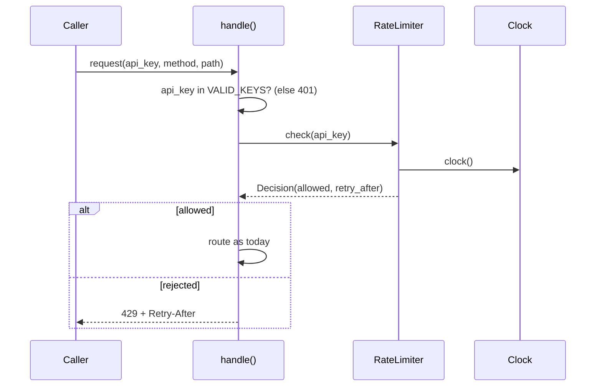

# Design Document: API key rate limiting

## Overview

A new module `shortlinks/ratelimit.py` holds a `RateLimiter`. It keeps, per API key, a deque of the times of Counted Requests (a sliding-window log). `handle()` in `shortlinks/api.py` calls `RateLimiter.check(api_key)` after the key check and before routing. A rejected request gets status 429, the body `{"error": "rate limit exceeded"}` and `headers["Retry-After"]`. All limiter state lives in process memory.

**Key design decisions:**
- Window algorithm: **sliding-window log** (not fixed window, not token bucket). Why: the Glossary defines the Window as the interval (now-60, now]. A fixed window lets a key send 120 requests in 2 s across a boundary, which breaks "60 per minute". A log gives exact `Retry-After` from the oldest entry (Requirement 2.2). Cost: up to 60 floats per key.
- One `threading.Lock` per limiter: check and append are one atomic step (Requirement 1.6). Cost: all keys share one lock; the critical section is O(evictions).
- Fail open: any exception from the limiter or Clock routes the request unlimited and logs at most one ERROR per 60 s per exception text (Requirement 1.8).
- Clock injection: `RateLimiter` takes `clock` in its constructor. `handle` takes an optional `limiter` argument, so a test passes `RateLimiter(clock=fake_clock)` and controls time with no monkeypatch and no sleep. Production calls omit it and use the module-level `_default_limiter` (clock = `time.monotonic`).

## Architecture



1. `handle()` validates the key. Invalid → 401, limiter not called (1.4).
2. `handle()` calls `limiter.check(api_key)` (default `_default_limiter`) inside `try/except Exception`.
3. `check()` takes the lock, reads the Clock once, evicts entries with `t + 60 <= now`, then allows (append `now`) or rejects (compute `Retry-After`).
4. Allowed → existing routing. Rejected → 429 Response.
5. Exception → log (throttled), route as if allowed, no count change.

## File/Folder Structure

```diff
 shortlinks/
 ├── __init__.py
-├── api.py              # routing
+├── api.py              # routing + limiter call + 429 response
+├── ratelimit.py        # RateLimiter, Decision, constants
 └── store.py
 tests/
+├── test_ratelimit.py   # unit + Hypothesis properties
 └── test_api.py         # + integration tests for 429
```

## Components and Interfaces

### RateLimiter (`shortlinks/ratelimit.py`)

Counts Counted Requests per key in the Window. Reads time from the Clock only.

```python
LIMIT = 60
WINDOW_SECONDS = 60

@dataclass(frozen=True)
class Decision:
    allowed: bool
    retry_after: int | None  # 1..60 when rejected, None when allowed

class RateLimiter:
    def __init__(self, limit: int = LIMIT, window: float = WINDOW_SECONDS,
                 clock: Callable[[], float] = time.monotonic) -> None: ...
    def check(self, api_key: str) -> Decision: ...
```

```diff
+check(api_key)
+  with self._lock
+    now = self._read_clock()          # last-seen guard, may raise ClockError
+    evict entries where t + window <= now
+    if len(log[api_key]) >= limit
+      oldest = log[api_key][0]
+      return Decision(False, clamp(ceil(oldest + window - now), 1, 60))
+    log[api_key].append(now)
+    return Decision(True, None)
```

_Requirements: 1.1, 1.2, 1.3, 1.6, 1.7, 2.2, 2.5, 3.1, 3.2, 3.3_

### handle (`shortlinks/api.py`)

Adds the limiter call and the 429 Response. The new `limiter` argument is optional, so existing callers `handle(request, store)` keep working.

```python
_default_limiter = RateLimiter()  # clock = time.monotonic
def handle(request: dict, store: LinkStore, limiter: RateLimiter | None = None) -> dict: ...
```

```diff
 handle(request, store)
+  limiter = limiter or _default_limiter
   check api_key in VALID_KEYS → 401
+  decision = limiter.check(api_key)   # try/except Exception → fail open
+  if not decision.allowed
+    return 429, headers {"Retry-After": str(decision.retry_after)}, body {"error": "rate limit exceeded"}
   route POST /links
   route GET /links/<code>
   fallback 404
```

_Requirements: 1.4, 1.5, 1.8, 2.1, 2.3, 2.4_

### Log throttle (`shortlinks/ratelimit.py`)

`_LogThrottle.should_log(text, now) -> bool`: true at most once per 60 s per exception text. Used by `handle()` on the fail-open path.

_Requirements: 1.8_

## Data Models

- `LIMIT = 60`, `WINDOW_SECONDS = 60`: module constants.
- `RateLimiter._log: dict[str, deque[float]]`: times of Counted Requests per key, oldest first. Max 60 entries per key.
- `RateLimiter._last_seen: float | None`: last Clock value, one per process (2.5).
- `Decision`: see above.

## Correctness Properties

Framework: Hypothesis (Python, from `pyproject.toml`).

### Property 1: Window count model

*For any* sequence of (key, time) requests with non-decreasing times, `check` SHALL allow a request if and only if fewer than 60 Counted Requests of that key have `now < t + 60`.

**Validates: Requirements 1.1, 1.2**

### Property 2: Key isolation

*For any* two request sequences for keys A and B, the decisions for A SHALL equal the decisions for A when B's requests are removed.

**Validates: Requirements 1.3**

### Property 3: Invalid key leaves state unchanged

*For any* request with a missing or unlisted `api_key`, `handle` SHALL return 401 and the limiter state SHALL equal the state before the request.

**Validates: Requirements 1.4**

### Property 4: Every route counts

*For any* method and path with a valid key, the allowed request SHALL add exactly one entry to that key's log.

**Validates: Requirements 1.5**

### Property 5: Atomic admission

*For any* n threads sending requests for one key with a frozen Clock and c prior Counted Requests, exactly min(n, max(0, 60 − c)) SHALL be allowed and each other SHALL get 429.

**Validates: Requirements 1.6**

### Property 6: Retry-After exact

*For any* request history, a response SHALL carry `Retry-After` if and only if its status is 429, and the value SHALL be `str(clamp(ceil(t_oldest + 60 − now), 1, 60))`.

**Validates: Requirements 2.1, 2.2, 2.4**

### Property 7: Clock guard

*For any* sequence of Clock readings, the `now` used by the limiter SHALL be non-decreasing, and a reading more than 60 s above the last-seen value SHALL raise a Clock error and leave last-seen unchanged.

**Validates: Requirements 2.5**

### Property 8: Fail open without state change

*For any* request with a valid key and a limiter or Clock that raises, `handle` SHALL return the same Response as routing without a limiter and no log entry SHALL be added.

**Validates: Requirements 1.8**

### Property 9: Recovery

*For any* key at the Limit, after any number of rejected requests, `Retry-After` SHALL never exceed the previous `Retry-After`, and a request at `now + Retry-After` SHALL be allowed.

**Validates: Requirements 3.1, 3.2, 3.3**

Example-only criteria: 1.7 (Clock injection, covered by every test), 1.9 (per-process scope, documented), 2.3 (fixed body).

## Error Handling

| Failure | Cause | Behavior | Caller sees |
|---|---|---|---|
| Limiter raises | bug in `check` | route request, no count change, throttled ERROR log | normal response |
| Clock raises | injected clock fails | same as above | normal response |
| Clock jumps > 60 s above last-seen | Requirement 2.5 | `ClockError`, treated as limiter exception | normal response |
| Clock goes backward | Requirement 2.5 | use last-seen as `now` | normal behavior |
| Key at the Limit | normal | 429 + `Retry-After` | 429 |

Dependency: `time.monotonic` (Clock). Entry above covers it.

**Design risk:** Requirement 2.5 (second sentence) treats any gap above 60 s since the last reading as a Clock error, and keeps last-seen unchanged. A caller idle for 61 s then triggers `ClockError`, and last-seen never advances. Every later request fails open. The limit stops working. This design follows the criterion as written. The criterion needs a fix through `/spec-sync` or a requirements edit.

## Testing Strategy

- Unit: `tests/test_ratelimit.py` with a `FakeClock` passed to `RateLimiter(clock=...)`.
- Property: Hypothesis, `@settings(max_examples=100)`, tag comment `Feature: api-key-rate-limiting, Property N: <title>`.
- Integration: `tests/test_api.py`. Tests call `handle(request, store, limiter=RateLimiter(clock=fake_clock))`. No test uses `time.sleep` or patches module state.
- Properties 1–9 above each have one test.
