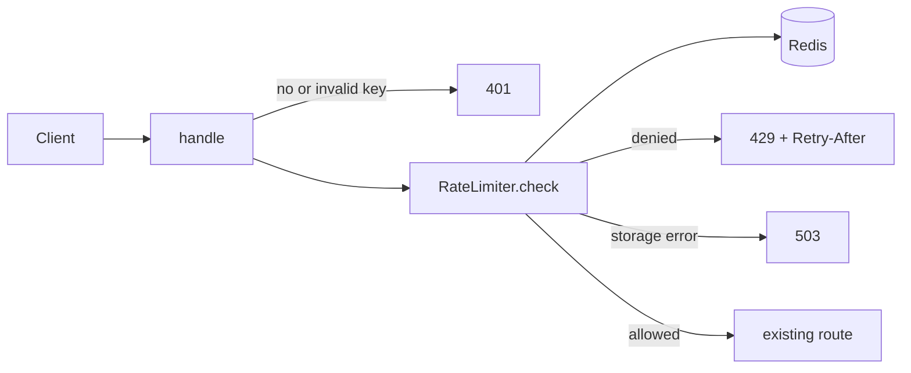

# Design Document: shortlinks-rate-limit

## Overview

Add a per-API-key rate limiter in front of the route handler. The limiter counts Counted Requests per API Key in shared storage (Redis). A Lua script checks the Limit and increments the count in one atomic step. The Window starts at the first Counted Request of a key.

**Key design decisions:**
- Check order is 401, then limit, then route: refused keys never count (Requirement 1.4).
- Redis holds counts: state is shared by all server instances (Requirement 1.7).
- Lua script checks and increments atomically: no race between instances (Requirement 1.6).
- Storage error or timeout returns 503: the route never runs without a count (Requirement 1.8).
- Window algorithm: **fixed** 60-second Window that starts at the first Counted Request. Reason: the Glossary defines Window this way, and it needs one hash per key (`start`, `count`). A sliding log would store one timestamp per Request, which costs more memory for up to 60 entries per key and needs a trim step per call. A fixed Window allows up to 120 allowed Requests across a Window boundary; the spec accepts this.
- Clock is injected (`Clock` protocol) so tests control time. Production uses `SystemClock`; tests use `FakeClock`.

## Architecture



1. `handle` checks the API Key. Invalid key returns 401 (Requirement 1.4).
2. `RateLimiter.check` runs the Lua script on `rl:{api_key}` (Requirements 1.5, 1.6, 1.7).
3. Denied: 429 with `Retry-After` (Requirements 1.2, 1.3).
4. Allowed: the existing route runs (Requirement 1.1).
5. Storage error or 100 ms timeout: 503 (Requirement 1.8).

## File/Folder Structure

```diff
 shortlinks/
 ├── __init__.py
 ├── api.py            # handle(): key check, limit check, route
+├── clock.py          # Clock protocol, SystemClock, FakeClock
+├── ratelimit.py      # RateLimiter, Decision, Redis Lua script
 └── store.py          # unchanged
 tests/
 ├── test_api.py       # existing + 429/503 cases
+├── test_ratelimit.py # unit tests
+└── test_properties.py # Hypothesis properties
```

## Components and Interfaces

### RateLimiter (`shortlinks/ratelimit.py`)

Interface:

```python
@dataclass(frozen=True)
class Decision:
    allowed: bool
    retry_after: int  # whole seconds, >= 1 when denied

class RateLimiter:
    def __init__(self, redis: Redis, clock: Clock, limit: int = 60, window_s: int = 60, timeout_s: float = 0.1) -> None: ...
    def check(self, api_key: str) -> Decision: ...  # raises StorageUnavailable

class Clock(Protocol):
    def now(self) -> float: ...  # epoch seconds
```

Call tree:

```diff
 RateLimiter.check(api_key)
+  now = self.clock.now()
+  EVAL count_script 1 rl:{api_key} now limit window
+  return Decision
```

_Requirements: 1.1, 1.2, 1.3, 1.5, 1.6_

### handle (`shortlinks/api.py`)

Interface: `def handle(request: dict, store: LinkStore, limiter: RateLimiter) -> dict`

Call tree:

```diff
 handle(request, store, limiter)
   check api_key in VALID_KEYS          (401)
+  limiter.check(api_key)
+    denied  -> 429 + Retry-After
+    error   -> 503
   route /links (existing)
```

_Requirements: 1.1, 1.4, 1.8_

## Data Models

Redis hash `rl:{api_key}`:
- `start`: float epoch seconds of the first Counted Request in the Window
- `count`: int, Counted Requests in the Window

Count script logic:

```diff
 on check(api_key, now)
+  if start is missing or now - start >= 60
+    set start = now, count = 0
+  if count < 60
+    count += 1, allowed
+  else
+    denied, retry_after = max(1, ceil(start + 60 - now))
+  EXPIRE key 60
```

Config: `REDIS_URL` env var. Timeout: 100 ms per call.

## Correctness Properties

### Property 1: Limit holds per Window

*For any* sequence of Requests with one valid API Key inside one Window, the SHALL count of allowed Requests is at most 60.

**Validates: Requirements 1.1, 1.2, 1.6**

### Property 2: Keys are independent

*For any* interleaving of Requests for two valid API Keys, the allowed count of each key SHALL be at most 60 and SHALL not change with the other key's Requests.

**Validates: Requirements 1.5**

### Property 3: Retry-After is bounded

*For any* denied Request, the Retry-After value SHALL be an integer from 1 to 60.

**Validates: Requirements 1.3**

### Property 4: Refused keys do not count

*For any* Request whose API Key is not in `VALID_KEYS`, the stored count SHALL be unchanged.

**Validates: Requirements 1.4**

### Property 5: Storage failure fails closed

*For any* Request when storage raises StorageUnavailable, the response SHALL be 503 and the route SHALL NOT run.

**Validates: Requirements 1.8**

## Error Handling

- Redis error or call over 100 ms: raise `StorageUnavailable`; `handle` returns 503. Route does not run.
- Invalid or missing key: 401 before any Redis call.
- Known gap: a script that commits after the client times out is still counted. Requirement 1.8 asks that such a write is discarded. Flagged for review.

## Testing Strategy

- Unit (`test_ratelimit.py`): fakeredis and `FakeClock`, one case per branch of the count script. Tests advance `FakeClock` to test Window reset and Retry-After.
- Property (`test_properties.py`): Hypothesis, 100 examples minimum per property (Properties 1–5). Each property draws its own clock times.
- Integration: `test_api.py` adds 429 and 503 cases through `handle`.
- Requirement 1.7 (shared storage) and the 100 ms timeout are checked by configuration review, not by property.
