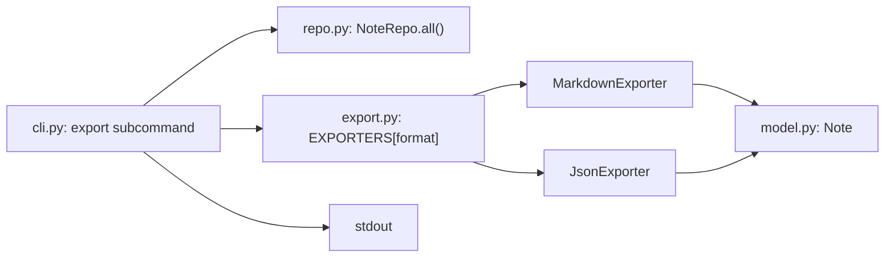

# Design Document: notes export subcommand

## Overview

Add an `export` subcommand to the notes CLI. It writes all notes to stdout as Markdown or JSON. Output formats are plugin-style exporters registered in `EXPORTERS`, per README fixed architecture. The export module does no file I/O.

Criteria (provisional, from the request until `requirements.md` exists):
- 1.1 Export all notes as Markdown.
- 1.2 Export all notes as JSON.
- 2.1 `export` subcommand selects the format with `--format`.

**Key design decisions:**
- New module `notes/export.py` holds exporters and `EXPORTERS`: keeps `repo.py` storage-only and keeps `cli.py` thin.
- Exporter contract: `render(notes) -> str`. Pure function, no I/O: testable without files.
- `--format` choices come from `EXPORTERS` keys: a new format needs one registry entry, no CLI edit.
- Default format `markdown`: decision taken without user input.
- Output to stdout only. File output is out of scope for this stage.

## Architecture



Request flow:
1. `cli.main` parses `export --format F`.
2. `cli.main` loads notes with `NoteRepo.all()`.
3. `cli.main` looks up `EXPORTERS[F]` and calls `render(notes)`.
4. `cli.main` prints the returned string to stdout.

## File/Folder Structure

```diff
 README.md                 # architecture; run and test commands
 pyproject.toml            # pytest config
 notes/
+├── export.py             # Exporter protocol, MarkdownExporter, JsonExporter, EXPORTERS
 ├── __init__.py
 ├── __main__.py           # entry point: raises SystemExit(main())
 ├── cli.py                # argparse subcommands; adds export
 ├── model.py              # Note dataclass (unchanged)
 └── repo.py               # NoteRepo load/save JSON (unchanged)
 tests/
 ├── test_repo.py
+├── test_export.py        # exporter unit tests
+└── test_cli_export.py    # export subcommand through main(argv)
```

## Components and Interfaces

### Exporter (`notes/export.py`)

Responsibility: turn a list of notes into one output string per format.

```python
from dataclasses import asdict
from typing import Protocol
import json

from notes.model import Note


class Exporter(Protocol):
    def render(self, notes: list[Note]) -> str: ...


class MarkdownExporter:
    def render(self, notes: list[Note]) -> str:
        # per note: "## {id}. {title}", blank line, body, blank line, "_{created_at}_"
        # notes joined by blank line; empty list -> ""
        ...


class JsonExporter:
    def render(self, notes: list[Note]) -> str:
        # json.dumps([asdict(n) for n in notes], indent=2); empty list -> "[]"
        ...


EXPORTERS: dict[str, Exporter] = {
    "markdown": MarkdownExporter(),
    "json": JsonExporter(),
}
```

Call tree of the new module:

```diff
+ MarkdownExporter.render(notes)
+   for note in notes
+     heading "## {id}. {title}"
+     body, created_at line
+   join sections with blank line
+ JsonExporter.render(notes)
+   [asdict(n) for n in notes]
+   json.dumps(indent=2)
```

_Requirements: 1.1, 1.2_

### CLI (`notes/cli.py`)

Responsibility: parse `export`, load notes, call exporter, print.

Call tree change of `main`:

```diff
 main(argv)
   ArgumentParser(prog="notes")
   add_subparsers(dest="cmd", required=True)
   sub.add_parser("add")
   sub.add_parser("list")
+  sub.add_parser("export")
+    add_argument("--format", choices=sorted(EXPORTERS), default="markdown")
   parse_args(argv)
   NoteRepo(Path("notes.json"))
   if cmd == "add":
     repo.add(title, body)
   elif cmd == "list":
     repo.all()
+  elif cmd == "export":
+    repo.all()
+    EXPORTERS[format].render(notes)
+    print(text)
```

Pseudocode for the new branch:

```diff
+ elif args.cmd == "export":
+   notes = repo.all()
+   text = EXPORTERS[args.format].render(notes)
+   print(text)
```

_Requirements: 2.1_

### NoteRepo (`notes/repo.py`)

Unchanged. `all()` is the read source for export.

```python
class NoteRepo:
    def __init__(self, path: Path) -> None: ...
    def all(self) -> list[Note]: ...   # [] when file missing
    def add(self, title: str, body: str) -> Note: ...
```

### Note (`notes/model.py`)

Unchanged. Fields used by exporters: `id`, `title`, `body`, `created_at`.

## Data Models

- `Note` (unchanged): `id: int`, `title: str`, `body: str`, `created_at: str` (ISO-8601 UTC).
- `EXPORTERS: dict[str, Exporter]`: keys are format names (`markdown`, `json`).
- Env vars: none.

## Correctness Properties

Framework: Hypothesis (Python). No property-test library is declared in `pyproject.toml`. Hypothesis is the mapped default (`shared/correctness.md` step 1).

Classification (`shared/correctness.md` step 2):
- 1.1 markdown sections → invariant → Property 1
- 1.2 json array → round-trip → Property 2
- 1.3 empty list → example-only
- 1.4 missing file → example-only
- 1.5 invalid JSON → error-condition → example-only
- 2.1 `--format` dispatch → example-only
- 2.2 default format → example-only
- 2.3 invalid format → error-condition → example-only

### Property 1: Markdown has one section per note, in order

*For any* list of Notes with arbitrary `id`, `title`, and `body` strings, `MarkdownExporter.render` SHALL return text that contains exactly one heading line `## <id>. <title>` per Note, in input order.

**Validates: Requirements 1.1**

### Property 2: JSON export round-trips the notes

*For any* list of Notes, `json.loads(JsonExporter.render(notes))` SHALL equal `[asdict(n) for n in notes]`.

**Validates: Requirements 1.2**

## Error Handling

- `notes.json` missing: `NoteRepo.all()` returns `[]`. Export prints an empty document. Not an error.
- `notes.json` invalid JSON: `json.JSONDecodeError` propagates. Existing behavior, unchanged. User sees a traceback, exit code 1.
- Unknown `--format`: argparse rejects it. User sees usage error, exit code 2.
- Stdout write failure (for example closed pipe): Python raises `BrokenPipeError` or `OSError`. Not handled. User sees traceback.

## Testing Strategy

- Unit (pytest): `MarkdownExporter` and `JsonExporter` on empty list, one note, and several notes. Library: pytest (existing).
- Integration (pytest): `main(["export", "--format", "json"])` with `capsys` and a `tmp_path` working directory. Covers cli wiring for each format.
- Property tests (Hypothesis, ≥100 iterations each, tag `Feature: notes-export-subcommand, Property N: <title>`):
  - Property 1: Markdown has one section per note, in order
  - Property 2: JSON export round-trips the notes
