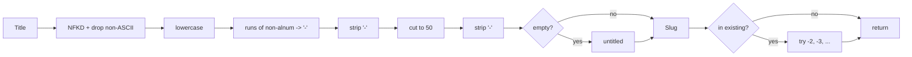

# Design Document: slugify and unique_slug

## Overview

One new module, `textkit/slug.py`, holds both functions. `slugify` is a pure pipeline: normalize, lowercase, replace runs, trim, truncate, trim, fallback. `unique_slug` calls `slugify` and probes suffixes `-2`, `-3`, ... until a free value is found. Python stdlib only (`re`, `unicodedata`). Hypothesis tests the properties.

**Key design decisions:**
- Pure functions, no state: `unique_slug` never mutates `existing`.
- Truncate before the final hyphen trim: output stays valid and `slugify` stays idempotent.
- Suffix added after truncation: `unique_slug` can return more than 50 characters. This keeps the base slug stable.
- Fallback `untitled` is applied last, so empty and all-symbol titles share one path.

## Architecture



Data flow:
1. `unique_slug(title, existing)` calls `slugify(title)`.
2. If the base is not in `existing`, return it.
3. Else test `base-2`, `base-3`, ... and return the first value not in `existing`.

## File/Folder Structure

```diff
 textkit/
 ├── __init__.py
 ├── words.py        # existing: word_count
+├── slug.py         # slugify, unique_slug
 tests/
 ├── test_words.py
+├── test_prop_slug_format.py      # Property 1
+├── test_prop_idempotent.py       # Property 2
+├── test_prop_ascii_only.py       # Property 3
+├── test_prop_unique_smallest.py  # Property 4
+└── test_prop_unique_pure.py      # Property 5
 pyproject.toml      # + dev extras: pytest, hypothesis
```

## Components and Interfaces

### slugify (`textkit/slug.py`)

```python
def slugify(title: str) -> str: ...
```

```diff
+slugify
+  unicodedata.normalize("NFKD")
+  encode("ascii", "ignore")
+  lower
+  re.sub(r"[^a-z0-9]+", "-")
+  strip("-")
+  [:50]
+  strip("-")
+  or "untitled"
```

_Requirements: 1.1, 1.2, 1.3, 1.4, 1.5, 1.6, 1.7_

### unique_slug (`textkit/slug.py`)

```python
def unique_slug(title: str, existing: set[str]) -> str: ...
```

```diff
+unique_slug
+  slugify
+  if base not in existing
+    return base
+  n = 2
+  while f"{base}-{n}" in existing
+    n += 1
+  return f"{base}-{n}"
```

_Requirements: 2.1, 2.2, 2.3, 2.4, 2.5, 2.6_

## Data Models

- `title: str`, 0–10000 characters.
- `existing: set[str]`, 0–10000 entries.
- Return: `str`.

## Correctness Properties

### Property 1: Slug format

*For any* `str` Title, slugify SHALL return a value that matches `^[a-z0-9]+(-[a-z0-9]+)*$` and has length ≤ 50.

**Validates: Requirements 1.2, 1.3, 1.4, 1.5, 1.6, 1.7**

### Property 2: Idempotence

*For any* `str` Title, slugify(slugify(Title)) SHALL equal slugify(Title).

**Validates: Requirements 1.2, 1.3, 1.4, 1.5, 1.6, 1.7**

### Property 3: Non-ASCII is dropped

*For any* `str` Title and any string C of CJK ideographs (U+4E00–U+9FFF), slugify(Title + C) SHALL equal slugify(Title).

**Validates: Requirements 1.1**

### Property 4: Smallest free slug

*For any* `str` Title and any `set[str]` Existing, unique_slug SHALL return a value not in Existing. The value SHALL be slugify(Title), or slugify(Title)-N with N ≥ 2, and every smaller candidate SHALL be in Existing.

**Validates: Requirements 2.1, 2.2, 2.3, 2.5, 2.6**

### Property 5: No mutation

*For any* `str` Title and any `set[str]` Existing, unique_slug SHALL leave Existing equal to a copy taken before the call.

**Validates: Requirements 2.4**

## Error Handling

No external dependency. No I/O. Callers pass `str` and `set[str]`. A wrong type raises the native `TypeError` or `AttributeError`; the module does not catch it. Empty or symbol-only titles are not errors: they return `untitled`.

## Testing Strategy

- Unit: example cases in each property file (`"Hello, World!"` → `hello-world`, `""` → `untitled`, `"Café"` → `cafe`).
- Property: Hypothesis, `@settings(max_examples=100)` minimum, one file per property. Each file carries the tag `Feature: slugify-unique-slug, Property N: <title>`.
  - Property 1: Slug format → `tests/test_prop_slug_format.py`
  - Property 2: Idempotence → `tests/test_prop_idempotent.py`
  - Property 3: Non-ASCII is dropped → `tests/test_prop_ascii_only.py`
  - Property 4: Smallest free slug → `tests/test_prop_unique_smallest.py`
  - Property 5: No mutation → `tests/test_prop_unique_pure.py`
- Library: Hypothesis. Runner: pytest.
- Command: `uv run --no-project --with pytest --with hypothesis python -m pytest`.
