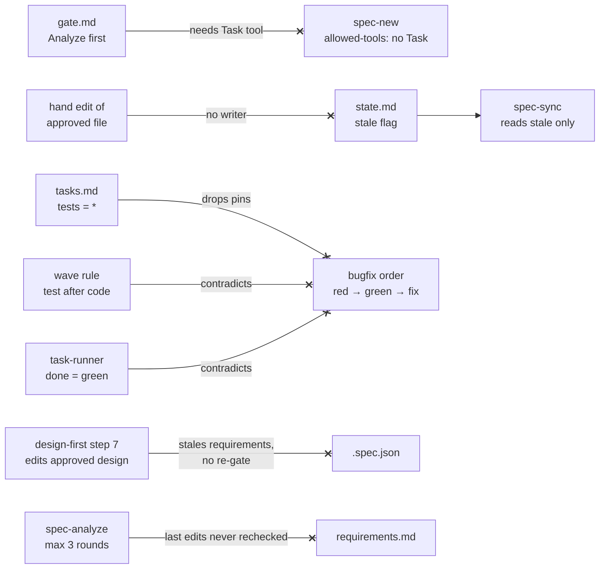

# sdd plugin evaluation: findings and proposed changes

Date: 2026-10-17 · Plugin: `plugins/sdd` v0.1.0 (commit `1ad2c46`) · Method: [harness.md](../../plugins/sdd/evals/harness.md)

> **Status 2026-10-18 (0.3.4):** f1, b1, a1 3/3 PASS on 0.3.2, 0.3.3 and 0.3.4. Open: 3 medium, 16 low in [OPEN-ISSUES.md](OPEN-ISSUES.md). Runs: [v0.3.2](v0.3.2/README.md), [v0.3.3](v0.3.3/README.md), [v0.3.4](v0.3.4/README.md).
>
> **Status 2026-10-18 (0.3.1):** f1 and a1 rerun 2/2 PASS; criteria growth +115 % → +42 %, recall 7/7: [v0.3.1/README.md](v0.3.1/README.md).
>
> **Status 2026-10-18:** real plugin test of v0.3.0 (installed, real agents, Opus orchestrator): 3/3 PASS, [v0.3.0/README.md](v0.3.0/README.md).
>
> **Status 2026-10-17:** changes applied in sdd v0.2.0. Reruns of 03 and 06: [v0.2.0/README.md](v0.2.0/README.md). 20 of 22 old issues in those scenarios fixed, 2 changed form, 0 still open.

## Verdict

The core design is good: a fixed artifact chain, hard gates, EARS, Done-when lines, and subagents that see one task. Both models completed every workflow.

The plugin is not consistent yet. Each file is clear when you read it alone. The defects are at the joins between files: a skill that cannot call the agent it needs, a task rule that breaks the bugfix order, and a state model that does not see manual edits. All 6 runs ended PARTIAL. The cause was these joins, not the models.

**Top 3 fixes:**

1. Make state detect changes itself (content hashes). Today `spec-sync` cannot see a hand edit, so its main use case fails silently (06-1, 06-2).
2. Fix the bugfix contract across `tasks.md`, `spec-run`, and `spec-task-runner`. Today the default run skips every test pin, and the exploration test cannot go red (03-1, 03-2, 03-3).
3. Give `spec-new` the agent tool and give `spec-analyze` a stop rule that verifies the last edits (01-1, 01-2, 02-3).

## Runs

| # | Scenario | Model | Skills | Result | Issues | Report |
|---|---|---|---|---|---|---|
| 01 | Requirements-First, rate limit | Sonnet | spec-new + analyze | PARTIAL | 12 | [report](01-reqfirst-sonnet/report.md) |
| 02 | Same input as 01 | Haiku | spec-new + analyze | PARTIAL | 15 | [report](02-reqfirst-haiku/report.md) |
| 03 | Bugfix, pagination off-by-one | Sonnet | spec-new, spec-run single | PARTIAL | 11 | [report](03-bugfix-sonnet/report.md) |
| 04 | Design-First, notes export | Haiku | spec-new | PARTIAL | 12 | [report](04-designfirst-haiku/report.md) |
| 05 | Seeded defects, recall | Haiku | spec-analyze | PARTIAL | 10 | [report](05-analyze-haiku/report.md) |
| 06 | Quick Plan → run → hand edit → sync → run | Sonnet | all four | PARTIAL | 11 | [report](06-lifecycle-sonnet/report.md) |

Each scenario folder keeps `workspace/` (fixture + generated spec + code) and `report.md`. The fixture sources are in [plugins/sdd/evals/fixtures](../../plugins/sdd/evals/fixtures).

Limits of this eval: the sessions simulated the skills. They read `SKILL.md` literally and used a scripted user. The real slash-command load, the `${CLAUDE_PLUGIN_ROOT}` expansion, and the `allowed-tools` enforcement were not tested, because the headless `claude` CLI was not logged in. `claude plugin validate` passed with 1 warning (no `author` in `.claude-plugin/plugin.json`).

## Kiro parity

Compared with 3 Kiro specs in [kiro/COMPARISON.md](kiro/COMPARISON.md). sdd matches the Kiro skeleton and is stricter on traceability. It differs in two ways:

| Gap | Kiro | sdd | Change |
|---|---|---|---|
| Requirement size | 6–9 requirements, ~21 words per criterion | 1–3 requirements, 35–42 words per criterion (max 99) | One requirement per capability, 2–7 criteria, one `SHALL`, ≤40 words. Analyze options add criteria, never extend them. |
| Leaf detail | 46–61 words, about 4 sub-bullets (command, export, test cases) | 22–35 words | Leaf format `Files` / `Do` / `Verify` / `_Requirements_`. |
| Failure rule | 0–29 % `IF` criteria | "every happy path needs a failure criterion" | Per requirement that takes input or calls a dependency. |
| Properties per test leaf | several allowed | one task per property | One leaf per test file. |
| Final checkpoint | names `pnpm test --run`, `pnpm typecheck` | no command | Write the commands into the checkpoint. |

## Where the joins break

## Model comparison (01 Sonnet vs 02 Haiku, same input and script)

| Measure | Sonnet (01) | Haiku (02) |
|---|---|---|
| Spec name | `api-key-rate-limiting` | `shortlinks-rate-limit` |
| Words req / design / tasks | 1152 / 1281 / 421 | 777 / 852 / 458 |
| Properties / leaves | 9 / 6 | 5 / 10 |
| Analyze rounds | 3 (cap hit) | 3 (cap hit) |
| Design choice | in-process limiter | Redis Lua script (not in fixture) |
| Defect let through | idle-gap rule disables limiter after 60 s | placeholder `<N> ms` applied; 1.8 not implementable |
| Found `allowed-tools` gap | yes | yes |

Notes:
- Both models finished every workflow and found the same high issues. The instructions are clear enough for Haiku.
- Output varies a lot between runs: name, size, and architecture all differ. Nothing in the skill pins the name rule or the "use the existing stack" rule.
- Both hit the analyze cap. The analyze loop adds scope each round (Sonnet: +89 % words). This is the biggest source of spec bloat.

## Issues by theme

Severity counts across all 6 reports: 15 high, 34 med, 22 low (71 total). Duplicates are merged below. IDs point to the reports.

### A. Contract breaks between files (high)

| Problem | IDs | Proposed change |
|---|---|---|
| `spec-new` cannot dispatch `spec-analyst`. `gate.md` names a "flow" with no path. | 01-1, 02-1, 02-15 | Add `Agent` (and `Task` for older hosts) to `spec-new` `allowed-tools`. In `gate.md`: "Read `${CLAUDE_PLUGIN_ROOT}/skills/spec-analyze/SKILL.md`, run its steps for this spec, then go back to gate step 1." |
| A hand edit is invisible. Only skills write `stale`. `spec-sync` checks only `stale`. | 06-1 | Store `hashes: {file: sha256}` in `.spec.json` at each Approve. `spec-sync` and `spec-run` step 1 compare the hashes. A mismatch marks later phases `stale` and names the file. |
| `spec-sync` cannot propagate a changed value. It matches criterion ids, not text. Done leaves are never checked again. | 06-2 | Store the criterion text hash per id. Changed text → un-tick every leaf that cites the id, and add a "re-verify" note. |
| Bugfix pins are `*`, so the default `spec-run` skips them. | 03-1 | `tasks.md`: exploration and preservation leaves are never `*`. |
| Wave rule "test after code" contradicts bugfix order. | 03-2 | Add an exception: in bugfix specs, pin leaves come before the fix leaf. |
| Runner "done = green" contradicts "exploration test goes red". The run after the fix gives `blocked`. | 03-3 | Runner: a leaf marked `expect: red` is `done` when it fails for the stated reason. `spec-run` refuses to run a pin leaf after the fix leaf is `[x]`. |
| Design-First step 7 edits the approved design, so requirements become `stale`, with no re-gate. | 04-2, 04-3 | Move "add properties" before the design gate (step 3), or add an explicit re-gate. Fix "until step 5" → correct step. |
| Design-First gate 2 asks "Which user needs does this miss?" but gives no rule for the answer. | 04-1 | Answer → add requirements. If the design cannot support them → "Request changes on design", stale cascade, re-gate design. |
| Analyze cap: round-3 edits are never rechecked. One edit disabled the limiter. 05 ended with 13 open findings. | 01-2, 02-3, 05-5 | After the last apply, run one verify-only pass: "report only defects that the edits introduced". At the cap, show open findings at the gate. |

### B. State machine gaps (med)

| Problem | IDs | Proposed change |
|---|---|---|
| Only the requirements step sets `draft`. | 01-4, 02-5, 03-8 | One rule in `state.md`: "Write artifact → phase `draft`." Delete per-step copies. |
| Approve does not say that it clears `stale`. | 04-7 | `gate.md`: Approve sets `approved` from `draft` or `stale`. |
| `spec-run` sends every not-approved state to `/spec-sync`. | 06-3 | Route by phase: `pending` → `/sdd:spec-new <name>`, `draft` → gate, `stale` → `/sdd:spec-sync`. |
| Single mode has no reset of `[-]`, no Retry, no checkpoint. | 03-4, 03-5 | Share one "after report" block between modes: non-done → `[ ]`, ask Retry / Skip / Stop; run checkpoints in both modes. |
| Group lines and checkpoints are never ticked. | 06-4 | Group → `[x]` when all in-scope leaves are `[x]`. Checkpoint → `[x]` when green. |
| No path back upstream when design finds a requirements defect. | 01-3 | Gate "Request changes" may name an upstream artifact. The edit follows the stale rule. |

Proposed `state.md` table (replaces the prose rules):

| Event | Writer | Effect |
|---|---|---|
| Artifact written | any spec skill | phase → `draft` |
| Gate Approve | `gate.md` | phase → `approved`, store file hash |
| Approved file edited (hash differs) | detected by `spec-sync`, `spec-run` | later phases in `order` → `stale` |
| `spec-sync` Apply | `spec-sync` | stale phases → `approved`, store hashes |

### C. Templates disagree with their own Done-when lists (med)

| Problem | IDs | Proposed change |
|---|---|---|
| Requirements skeleton numbers `1.`; Done-when needs `N.M`. `## Open Questions` is missing. | 01-5, 02-13 | Keep the Kiro form (`1.` in the list, cited as `N.M`). Fix the Done-when text: "numbered per requirement, cited as `N.M`". Add `## Open Questions` to the skeleton. |
| One design Done-when list for two skeletons. "Replace middle sections" names no sections. | 03-6 | Split into `artifacts/design.md` and `artifacts/bugfix-design.md`, each with its own Done-when list. |
| Criteria classification is required but has no slot. "Lists every property from correctness.md" points to the wrong file. | 02-6, 02-7 | Add a "Criteria classification" table to the design skeleton. Say "every Property N in this file". |
| Bugfix "Validation Properties" are bullets; tasks expect `Property N`. | 03-10 | Use `### Property N` headings in the bugfix skeleton. |
| Bugfix Done-when needs "code read exposed" neighbors before the code is read. | 03-11 | Order: facts → investigate → draft `bugfix.md`. |
| Design-First checks criteria before requirements exist; no reverse coverage check. | 04-4, 04-5 | Design-First design Done-when skips criterion mapping. Requirements Done-when adds: every criterion cites ≥1 component. |
| Tasks: no `Files:` line in the skeleton, "layer" and "test leaf" undefined, no `deps` in the graph. | 01-9, 04-8, 04-9 | Leaf schema: `Files:`, `Kind: setup \| code \| test \| pin`, `_Requirements:_` (or `none (setup)`). Graph JSON adds `deps` per leaf. Layer = top-level group. |
| Same-wave rule checks writes only. A runner read a file while another runner rewrote it. | 06-6 | Same-wave leaves must not read a file that another leaf in the wave writes. |
| Properties in one test file force one wave each. | 02-8 | Allow one leaf per test file holding several properties. Align `correctness.md` "task per property". |

### D. Analyst quality (high/med)

Scenario 05 measured `spec-analyst` (Haiku) on a seeded spec with 7 planted defects:

| Measure | Result |
|---|---|
| Recall, round 1 | 7 / 7 (K4 partial: "support agent" not named) |
| Round-1 findings | 21: 10 match the key, 7 valid extras, 3 arguable on the clean control, 1 false positive |
| New defects caused by the apply step | round 2: 3, round 3: 4 |
| Open non-deferred findings at cap | 13 (no convergence) |
| Questions for the user | 53 (≈15 AskUserQuestion calls) |
| Stale marking after edit | correct: design, tasks → `stale` |

The analyst finds defects well. The loop around it is the problem: options are not exact text, the apply step does not check EARS or merge edits to the same criterion, and the analyst cannot see what was deferred. 53 questions for 7 requirements is too many for a real user.

| Problem | IDs | Proposed change |
|---|---|---|
| IDs restart each round. Deferred items come back as new (5 times in 05). | 01-6, 02-11, 05-1, 05-7 | Pass prior IDs and deferred IDs to the analyst. New IDs continue the sequence. |
| Option text breaks EARS or holds placeholders (`<N> ms`, `...`, `[N]`). | 02-9, 02-10, 05-2, 05-3 | Option A must be one EARS criterion with concrete values. Else the finding is Defer-only. |
| Option A grows scope every round. | 01-7 | "Prefer the smallest change. Mark out-of-scope ideas `low`." Stop when a round finds only `low`. |
| "≤4 per call" with no grouping key. | 02-4, 05-6 | Group by affected requirement. |
| Two chosen options edit the same criterion and conflict. | 05-4 | Step 4: merge edits per criterion, show the merged text once. |
| False positives on clean text. | 05-9 | Each finding quotes the criterion text it disputes. |
| Too many questions (53). | 05 metrics | Ask only high/med. Auto-defer low into `## Open Questions` and list them at the gate. |

### E. Names, paths, packaging (low)

| Problem | IDs | Proposed change |
|---|---|---|
| Text says `/spec-run`, `/spec-sync`. Installed names are `/sdd:spec-*`. | 01-11, 03-9, 06-10 | Use `/sdd:spec-*` everywhere. |
| `allowed-tools: Task`; the host tool is `Agent`. Background dispatch with no "wait". | 02-2, 06-8 | List both. Add "wait for every report before marking". |
| "Read only the chosen file" vs Done-when links to `visuals.md` and `correctness.md`. | 06-11 | "Read the chosen file and the files it links when you reach them." |
| Spec name rule is vague. | 02-12, 04-12 | "Feature noun phrase, ≤5 words, drop the workflow name." |
| "One-line change → no spec" can override a named Bugfix. | 03-7 | A named workflow wins over the size rule. |
| Analyze-first offer rule differs between `gate.md` and `requirements-first.md`. Unclear for Design-First. | 01-8, 04-6 | `gate.md` always lists it for the requirements phase. Workflows say when to recommend it. |
| Test command source is undefined. Runners pick a file or the full suite at random. | 06-5, 06-7 | Read the test and typecheck commands from manifest or README. If none → report "none". Runner runs its own test files. Checkpoint runs the full suite. |
| Two `plugin.json` files with different descriptions. `.claude-plugin/plugin.json` has no author. README test command `--plugin-dir ./sdd` is wrong from the repo root. | own check | Keep one description. Add author. Use `claude --plugin-dir plugins/sdd`. |

## Proposed structural changes

1. **One state table** in `state.md` (above). Workflows reference events, not phase values.
2. **Ship a validator.** Three sessions wrote the same graph checker. Add `shared/scripts/check_tasks.py` (graph parses, one wave per leaf, deps order, disjoint read/write, coverage) and call it in the tasks Done-when and in `spec-run` step 4. Deterministic checks are cheaper and more reliable than model judgment.
3. **Leaf schema, not prose.** Fixed fields (`Files`, `Kind`, `Requirements`, `Expect`) make bugfix pins, setup leaves, and optional tests explicit.
4. **One artifact file per skeleton.** Each skeleton holds every section that its Done-when names.
5. **Analyze contract.** Prior IDs in, concrete EARS options out, smallest change, verify-only final pass.
6. **Keep this eval as a regression suite.** Move `harness.md` and `_fixtures/` to `plugins/sdd/evals/`. Run scenarios 03 and 06 after each change, because they hit the most joins.

Version: items in A and B change workflow behavior and the `.spec.json` schema (`hashes`). Bump to `0.2.0` (pre-1.0 minor = breaking allowed) and update `plugins/sdd/README.md`.
