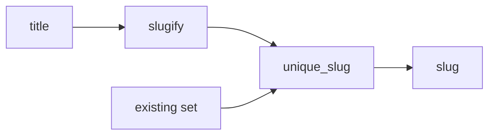

# Design Document: Title slugs

## Overview

Two pure functions in two new modules. `slugify` does NFKD, ASCII filter, lowercase, hyphen collapse, truncate. `unique_slug` calls `slugify` and adds a numeric suffix until the result is free.

**Key design decisions:**
- Two modules: tests and code for each function touch disjoint files.
- Truncate before suffix: the base is cut to `40 - len(suffix)` so the total stays within the limit.
- No mutation: `unique_slug` only reads `existing`.

## Architecture



1. `slugify` normalizes the title to a Slug.
2. `unique_slug` calls `slugify`.
3. If the Slug is in `existing`, it tries `-2`, `-3`, … with a shortened base.

## File/Folder Structure

```diff
 textkit/
 ├── __init__.py
 ├── words.py
+├── slug.py          # slugify
+└── unique.py        # unique_slug
 tests/
 ├── test_words.py
+├── test_slug.py         # slugify tests
+└── test_unique_slug.py  # unique_slug tests
```

## Components and Interfaces

### Slug_Generator (`textkit/slug.py`)

Turns a Title into a Slug.

```python
MAX_LEN = 40
def slugify(title: str) -> str: ...
```

```diff
+slugify
+  unicodedata.normalize("NFKD")
+  encode ascii, ignore
+  lower
+  re.sub non-alphanumeric runs -> "-"
+  strip "-"
+  truncate to MAX_LEN, strip "-"
+  empty -> "untitled"
```

_Requirements: 1.1, 1.2, 1.3, 1.4, 1.5, 1.6_

### Unique_Slug_Generator (`textkit/unique.py`)

Returns a Slug not in `existing`.

```python
def unique_slug(title: str, existing: set[str]) -> str: ...
```

```diff
+unique_slug
+  slug = slugify(title)
+  if slug not in existing: return slug
+  n = 2
+  loop
+    suffix = f"-{n}"
+    candidate = slug[:MAX_LEN - len(suffix)].rstrip("-") + suffix
+    if candidate not in existing: return candidate
+    n += 1
```

_Requirements: 2.1, 2.2, 2.3, 2.4, 2.5_

## Data Models

None. Input `str`, output `str`, `existing: set[str]`.

## Criteria Classification

| Criterion | Class | Property |
|---|---|---|
| 1.1 | invariant | 1 |
| 1.2 | example-only | none |
| 1.3 | invariant | 1 |
| 1.4 | invariant | 2 |
| 1.5 | error-condition | none |
| 1.6 | idempotence | 3 |
| 2.1 | invariant | 4 |
| 2.2 | invariant | 4 |
| 2.3 | invariant | 5 |
| 2.4 | invariant | 4 |
| 2.5 | error-condition | none |

## Correctness Properties

### Property 1: Slug shape

*For any* Title, `slugify` SHALL return a string that matches `^[a-z0-9]+(-[a-z0-9]+)*$`.

**Validates: Requirements 1.1, 1.3**

### Property 2: Slug length

*For any* Title, `len(slugify(title))` SHALL be at most 40.

**Validates: Requirements 1.4**

### Property 3: Slug idempotence

*For any* Title, `slugify(slugify(title))` SHALL equal `slugify(title)`.

**Validates: Requirements 1.6**

### Property 4: Uniqueness

*For any* Title and any `existing` set, `unique_slug` SHALL return a value not in `existing`, SHALL return `slugify(title)` when that is not in `existing`, and SHALL leave `existing` unchanged.

**Validates: Requirements 2.1, 2.2, 2.4**

### Property 5: Unique slug length

*For any* Title and any `existing` set, `len(unique_slug(title, existing))` SHALL be at most 40.

**Validates: Requirements 2.3**

## Error Handling

No external dependency. Non-ASCII characters that NFKD does not reduce are dropped. Empty result becomes "untitled".

## Testing Strategy

Unit tests for 1.2, 1.5, 2.5. Property tests with Hypothesis.

| Property | Generators | Iterations |
|---|---|---|
| 1 | `st.text()` | ≥100 |
| 2 | `st.text(max_size=1000)` | ≥100 |
| 3 | `st.text()` | ≥100 |
| 4 | `st.text()`, `st.sets(st.text())` plus slugs of the title | ≥100 |
| 5 | `st.text()`, `st.sets(st.text())` plus slugs of the title | ≥100 |
