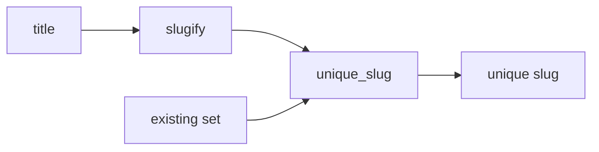

# Design Document: slugify

## Overview

Two pure functions in two new modules. `slugify` normalizes with NFKD, encodes to ASCII, lowercases, replaces runs of non-alphanumerics with one hyphen, truncates to 40 characters, strips hyphens. `unique_slug` calls `slugify` and appends `-N`, trimming the base so the total stays within 40.

**Key design decisions:**
- Pure functions, no state: `existing` is read only, so callers own insertion.
- Truncate before suffix: base is cut to `40 - len("-N")` so the suffix always fits.

## Architecture



1. `unique_slug` calls `slugify(title)`.
2. If result is free, return it.
3. Else try suffix 2, 3, ... until free.

## File/Folder Structure

```diff
 textkit/
 ├── __init__.py
 ├── words.py
+├── slug.py       # slugify
+└── unique.py     # unique_slug
 tests/
 ├── test_words.py
+├── test_slugify.py
+└── test_unique_slug.py
```

## Components and Interfaces

### Slugifier (`textkit/slug.py`)

Turns a title into a slug.

```python
MAX_LEN = 40
def slugify(title: str) -> str: ...
```

```diff
+slugify
+  unicodedata.normalize("NFKD")
+  encode ascii, ignore
+  lower, re.sub non-alnum runs -> "-"
+  cut to MAX_LEN, strip "-"
+  empty -> "untitled"
```

_Requirements: 1.1, 1.2, 1.3, 1.4, 1.5_

### Slug_Allocator (`textkit/unique.py`)

Returns a slug free in `existing`.

```python
def unique_slug(title: str, existing: set[str]) -> str: ...
```

```diff
+unique_slug
+  base = slugify(title)
+  if base not in existing: return base
+  for n in 2..:
+    suffix = f"-{n}"
+    cand = base[:MAX_LEN - len(suffix)].rstrip("-") + suffix
+    if cand not in existing: return cand
```

_Requirements: 2.1, 2.2, 2.3, 2.4, 2.5_

## Data Models

None. `existing` is `set[str]`.

## Criteria Classification

| Criterion | Class | Property |
|---|---|---|
| 1.1 | invariant | 1 |
| 1.2 | example-only | - |
| 1.3 | invariant | 1 |
| 1.4 | example-only | - |
| 1.5 | idempotence | 2 |
| 2.1 | example-only | - |
| 2.2 | invariant | 3 |
| 2.3 | invariant | 3 |
| 2.4 | invariant | 3 |
| 2.5 | metamorphic | 4 |

## Correctness Properties

### Property 1: Slug shape

*For any* Unicode string, `slugify` SHALL return a string matching `^[a-z0-9]+(-[a-z0-9]+)*$` of at most 40 characters.

**Validates: Requirements 1.1, 1.3**

### Property 2: Slugify idempotent

*For any* Unicode string `t`, `slugify(slugify(t))` SHALL equal `slugify(t)`.

**Validates: Requirements 1.5**

### Property 3: Unique result

*For any* title and any `set[str]` `existing`, `unique_slug` SHALL return a string not in `existing`, of at most 40 characters, and SHALL leave `existing` equal to its prior copy.

**Validates: Requirements 2.2, 2.3, 2.4**

### Property 4: Empty set equals slugify

*For any* title, `unique_slug(title, set())` SHALL equal `slugify(title)`.

**Validates: Requirements 2.5**

## Error Handling

No external dependency. Non-string input raises `TypeError` from Python; not specified.

## Testing Strategy

Unit tests for examples (1.2, 1.4, 2.1). Hypothesis for properties.

| Property | Generators | Iterations |
|---|---|---|
| 1 | `st.text()` | ≥100 |
| 2 | `st.text()` | ≥100 |
| 3 | `st.text()`, `st.sets(st.text())` plus slug-shaped sets | ≥100 |
| 4 | `st.text()` | ≥100 |
