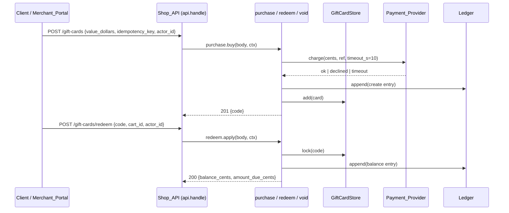

# Design Document: gift-cards

## Overview

Add gift cards to the existing `handle(request, ctx)` API. Three new service modules (`purchase`, `redeem`, `void`) hold the logic. They share a `GiftCardStore` (in-memory, one lock per card), a `Ledger` (append-only, can fail), and a `PaymentProvider` port (injected through `ctx`). `shop/api.py` only routes. Every state change writes the ledger entry first and commits the change only after the write succeeds.

**Key design decisions:**
- Ports in `ctx` (`payments`, `ledger`, `giftcards`, `staff_ids`): tests inject fakes; no network in tests.
- Ledger-before-commit: a failed ledger write leaves no change (5.2) without rollback code.
- One `threading.Lock` per card code: redemptions and voids on one card run in sequence (2.7).
- Purchase idempotency map `key → first response` in `GiftCardStore` (1.9, 1.10). A request without a key is not deduplicated.
- Redemption route is `POST /gift-cards/redeem` with `cart_id` in the body, so a missing or closed Cart gives `invalid_request` (2.8), not the existing `/carts/<id>` 404.
- Open Questions F11, F12, F22, F24–F26 stay open. Conservative choices here: ledger `old` = `None` on create; `actor_id` = request body value; manual-refund queue is an in-memory list on `Ledger`.

## Architecture



1. `api.handle` matches method + path and calls one service function.
2. The service validates input, then talks to ports in this order: Payment_Provider → Ledger → GiftCardStore.
3. The service returns `{"status", "body"}`; `api.handle` returns it unchanged.

## File/Folder Structure

```diff
 shop/
 ├── api.py              # routes; adds 3 gift-card routes
 ├── cart.py             # Cart gains `open` flag
+├── giftcards.py        # GiftCard, GiftCardStore, per-card locks, code generator
+├── ledger.py           # Ledger, LedgerUnavailable, manual-refund queue
+├── payments.py         # PaymentProvider protocol, ChargeResult
+├── purchase.py         # buy(): charge, ledger, create, idempotency
+├── redeem.py           # apply(): checks, subtract, amount due
+└── void.py             # void(): staff check, set status
 tests/
+├── fakes.py            # FakePaymentProvider, FailingLedger
+├── test_purchase.py    # Properties 1–4, 10
+├── test_redeem.py      # Properties 5–7
+├── test_void.py        # Property 8
+├── test_ledger_audit.py # Property 9
+└── test_api_giftcards.py # routes end to end
```

## Components and Interfaces

### GiftCardStore (`shop/giftcards.py`)

Holds cards, per-card locks, purchase idempotency results.

```python
MAX_BALANCE_CENTS = 50_000
CODE_LEN = 16

@dataclass
class GiftCard:
    code: str
    balance_cents: int
    status: Literal["active", "void"] = "active"

class GiftCardStore:
    def new_code(self) -> str: ...                    # 16 chars, A-Z0-9, unique
    def add(self, card: GiftCard) -> None: ...        # raises ValueError if balance > MAX_BALANCE_CENTS
    def get(self, code: str) -> GiftCard | None: ...
    def lock(self, code: str) -> threading.Lock: ...
    idempotent: dict[str, dict]                       # key -> first response
```

_Requirements: 2.3, 2.7, 4.1_

### Ledger (`shop/ledger.py`)

```python
class LedgerUnavailable(Exception): ...

@dataclass(frozen=True)
class Entry:
    code: str; field: Literal["balance", "status"]
    old: int | str | None; new: int | str; actor_id: str; at: datetime  # UTC

class Ledger:
    entries: list[Entry]
    manual_refunds: list[dict]                        # {charge_id, amount_cents, at}
    def append(self, entry: Entry) -> None: ...       # may raise LedgerUnavailable
```

_Requirements: 5.1, 5.2, 5.4_

### PaymentProvider (`shop/payments.py`)

```python
@dataclass(frozen=True)
class ChargeResult:
    status: Literal["ok", "declined", "timeout"]
    charge_id: str | None = None

class PaymentProvider(Protocol):
    def charge(self, amount_cents: int, ref: str, timeout_s: float) -> ChargeResult: ...
    def refund(self, charge_id: str) -> None: ...     # may raise
    def cancel(self, ref: str) -> None: ...           # cancel or refund any later-confirmed charge for ref
```

_Requirements: 1.3, 1.6_

### purchase (`shop/purchase.py`)

```python
CHARGE_TIMEOUT_S = 10
def buy(body: dict, ctx: dict) -> dict: ...           # {"status", "body"}
```

```diff
+buy
+  if key in store.idempotent: return stored response          # 1.9, 1.10
+  if value not whole dollars in 10..500: 422 invalid_request  # 1.7, 1.8
+  ref = new purchase ref
+  result = payments.charge(value*100, ref, 10)                # 1.1
+  if result is timeout: payments.cancel(ref)                  # 1.6
+  if result not ok: 402 payment_failed, no card               # 1.3, 1.4
+  code = store.new_code()
+  try ledger.append(create entry, old=None)                   # 5.1
+  except LedgerUnavailable:
+    try payments.refund(charge_id)                            # 5.3
+    except: ledger.manual_refunds.append(...)                 # 5.4
+    503 ledger_unavailable                                    # 5.2
+  store.add(GiftCard(code, value*100))                        # 1.5
+  response = 201 {code}                                       # 1.2
+  if key: store.idempotent[key] = response
```

_Requirements: 1.1, 1.2, 1.3, 1.4, 1.5, 1.6, 1.7, 1.8, 1.9, 1.10, 5.1, 5.2, 5.3, 5.4_

### redeem (`shop/redeem.py`)

```python
def apply(body: dict, ctx: dict) -> dict: ...
```

```diff
+apply
+  cart = ctx["carts"].get(cart_id)
+  if len(code) != 16 or cart is None or not cart.open: 422 invalid_request  # 2.8, 2.9
+  card = store.get(code); if None: 404 unknown_card                        # 2.4
+  with store.lock(code):                                                   # 2.7
+    if card.status == "void": 409 card_void                                # 3.2
+    s = cart.subtotal_cents(); b = card.balance_cents
+    new_b, due = (b - s, 0) if s <= b else (0, s - b)                      # 2.1, 2.5, 2.6
+    ledger.append(balance entry b -> new_b)   # LedgerUnavailable -> 503   # 5.1, 5.2
+    card.balance_cents = new_b
+  200 {balance_cents: new_b, amount_due_cents: due}
```

_Requirements: 2.1, 2.2, 2.4, 2.5, 2.6, 2.7, 2.8, 2.9, 3.2, 5.1, 5.2_

### void (`shop/void.py`)

```python
def void(code: str, body: dict, ctx: dict) -> dict: ...
```

```diff
+void
+  if body.actor_id not in ctx["staff_ids"]: 403 forbidden, no change   # 3.3, 3.4
+  card = store.get(code); if None: 404 unknown_card
+  with store.lock(code):                                               # 2.7
+    if card.status == "void": 409 card_void
+    ledger.append(status entry active -> void)  # failure -> 503       # 5.1, 5.2
+    card.status = "void"                                               # 3.1
+  200 {code, status: "void"}
```

_Requirements: 3.1, 3.3, 3.4, 5.1, 5.2_

### Shop_API routes (`shop/api.py`)

```diff
 handle
+  POST /gift-cards               -> purchase.buy(body, ctx)
+  POST /gift-cards/redeem        -> redeem.apply(body, ctx)
+  POST /gift-cards/<code>/void   -> void.void(code, body, ctx)   # Merchant_Portal
   POST /carts ...
```

_Requirements: 1.2, 3.1_

### Cart (`shop/cart.py`)

```diff
 class Cart:
   __init__
+    self.open = True
```

_Requirements: 2.8_

## Data Models

- `ctx` adds: `giftcards: GiftCardStore`, `ledger: Ledger`, `payments: PaymentProvider`, `staff_ids: set[str]`.
- Purchase body: `{"value_dollars": int, "idempotency_key"?: str, "actor_id": str}`.
- Redeem body: `{"code": str, "cart_id": str, "actor_id": str}`.
- Void body: `{"actor_id": str}`.
- Money: integer cents. `MAX_BALANCE_CENTS = 50_000`. Value range 10–500 whole dollars → 1 000–50 000 cents.

## Criteria Classification

| Criterion | Class | Property |
|---|---|---|
| 1.1 | invariant | 1 |
| 1.2 | invariant | 1 |
| 1.3 | error-condition | 3 |
| 1.4 | error-condition | 3 |
| 1.5 | invariant | 1 |
| 1.6 | error-condition | 3 |
| 1.7 | error-condition | 2 |
| 1.8 | error-condition | 2 |
| 1.9 | idempotence | 4 |
| 1.10 | idempotence | 4 |
| 2.1 | model | 5 |
| 2.2 | example-only | — |
| 2.3 | invariant | 5 |
| 2.4 | error-condition | 7 |
| 2.5 | model | 5 |
| 2.6 | model | 5 |
| 2.7 | invariant | 6 |
| 2.8 | error-condition | 7 |
| 2.9 | error-condition | 7 |
| 3.1 | invariant | 8 |
| 3.2 | error-condition | 7 |
| 3.3 | error-condition | 8 |
| 3.4 | error-condition | 8 |
| 4.1 | example-only | — |
| 5.1 | invariant | 9 |
| 5.2 | error-condition | 9 |
| 5.3 | error-condition | 10 |
| 5.4 | error-condition | 10 |

## Correctness Properties

### Property 1: Valid purchase creates a matching card

*For any* whole-dollar value v in 10–500 and a Payment_Provider that returns `ok`, Shop_API SHALL charge exactly v×100 cents once, return 201 with a 16-character code, and hold an `active` Gift_Card with balance v×100 under that code.

**Validates: Requirements 1.1, 1.2, 1.5**

### Property 2: Invalid purchase value is rejected without a charge

*For any* value that is not a whole-dollar integer in 10–500 (below, above, fractional, missing, non-number), Shop_API SHALL return 422 `invalid_request` and make zero charge calls.

**Validates: Requirements 1.7, 1.8**

### Property 3: Failed charge creates no card

*For any* valid value and a Payment_Provider that returns `declined` or `timeout`, Shop_API SHALL return 402 `payment_failed` and the store SHALL hold no new card; on `timeout` it SHALL call `cancel` with the purchase ref.

**Validates: Requirements 1.3, 1.4, 1.6**

### Property 4: Purchase is idempotent per key

*For any* valid purchase repeated n ≥ 2 times with one idempotency key, Shop_API SHALL return n equal responses and make exactly one charge.

**Validates: Requirements 1.9, 1.10**

### Property 5: Redemption follows the balance model

*For any* active card balance b in 0–50 000 cents and Cart subtotal s ≥ 0, redemption SHALL return 200 with new balance max(b−s, 0) and amount due max(s−b, 0), and the card balance SHALL never exceed 50 000 or fall below 0.

**Validates: Requirements 2.1, 2.3, 2.5, 2.6**

### Property 6: Concurrent operations never overspend

*For any* active card and k concurrent redemptions (threads) on open Carts, the sum of subtracted amounts SHALL equal the initial balance minus the final balance, and the final balance SHALL be ≥ 0.

**Validates: Requirements 2.7**

### Property 7: Redemption error precedence

*For any* request combining a bad code length or missing/closed Cart, an unknown code, and a `void` card, Shop_API SHALL return the first applicable error in the order 422 `invalid_request`, 404 `unknown_card`, 409 `card_void`, and SHALL not change any balance.

**Validates: Requirements 2.4, 2.8, 2.9, 3.2**

### Property 8: Only staff can void

*For any* actor id, a void request SHALL set the card to `void` when the id is in `staff_ids`, and otherwise return 403 `forbidden` with the card unchanged.

**Validates: Requirements 3.1, 3.3, 3.4**

### Property 9: Every change is audited, or nothing changes

*For any* sequence of purchase, redeem, and void operations, each balance or status change SHALL append exactly one ledger entry with code, old, new, actor id, and a UTC timestamp; when the ledger raises, Shop_API SHALL return 503 `ledger_unavailable` and the store SHALL be unchanged.

**Validates: Requirements 5.1, 5.2**

### Property 10: Ledger failure after charge refunds or queues

*For any* valid purchase where the charge succeeds and the ledger raises, Shop_API SHALL call `refund` with the charge id; when `refund` raises, the charge SHALL appear once in the manual-refund queue.

**Validates: Requirements 5.3, 5.4**

## Error Handling

| Dependency / failure | Cause | Behavior | User-visible result |
|---|---|---|---|
| Payment_Provider declines | card refused | no card, no ledger entry | 402 `payment_failed` |
| Payment_Provider no answer in 10 s | network, outage | `cancel(ref)`; no card | 402 `payment_failed` |
| Payment_Provider refund raises | outage | entry in `ledger.manual_refunds` | 503 `ledger_unavailable` |
| Ledger append raises | storage down | change not committed; refund on purchase | 503 `ledger_unavailable` |
| Bad input | wrong value, code length, closed Cart | no change | 422 `invalid_request` |
| Unknown code | typo, guess | no change | 404 `unknown_card` |
| Void card | card was voided | no change | 409 `card_void` |
| Non-staff void | missing or unknown actor | no change | 403 `forbidden` |

## Testing Strategy

Hypothesis property tests via `uv run --no-project --with pytest --with hypothesis python -m pytest -q`. Fakes in `tests/fakes.py`. Each test file carries `# Feature: gift-cards, Property N: <title>` per property. 2.2 (latency): example test, 200 redemptions, 95th percentile < 2 s, owner `redeem.apply`. 4.1: example test, no code path changes a balance except redemption (no expiry job exists).

| Property | Generators | Iterations |
|---|---|---|
| 1 | `integers(10, 500)` | ≥100 |
| 2 | `one_of(integers(<10), integers(>500), floats, text, none)` | ≥100 |
| 3 | `integers(10, 500)`, `sampled_from(["declined", "timeout"])` | ≥100 |
| 4 | `integers(10, 500)`, `integers(2, 5)` repeats, `text(min_size=1)` key | ≥100 |
| 5 | `integers(0, 50_000)` balance, cart lines from `CATALOG` | ≥100 |
| 6 | `integers(0, 50_000)` balance, `lists(cart lines, 2..8)` threads | ≥100 |
| 7 | `booleans()` × 3 fault flags, `text` codes | ≥100 |
| 8 | `text()` actor ids, `sets(text())` staff ids | ≥100 |
| 9 | `lists(sampled_from(ops))`, `booleans()` ledger-fails flag | ≥100 |
| 10 | `integers(10, 500)`, `booleans()` refund-fails flag | ≥100 |
