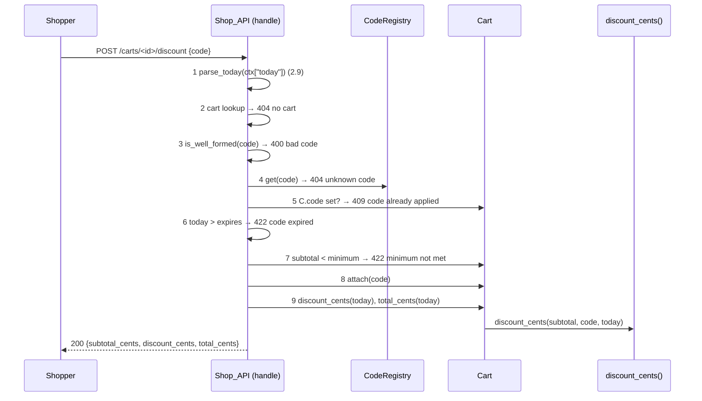

# Design Document: cart-discount-codes

## Overview

A new module `shop/discounts.py` holds the `DiscountCode` record, the `CodeRegistry`, the Code_String format check, the `today` parser, and one pure function `discount_cents(subtotal, code, today)`. `Cart` holds at most one `DiscountCode` and asks the pure function for its discount. `handle()` gets three routes changed or added and reads `ctx["codes"]` and `ctx["today"]`. Discount math lives in one pure function, so property tests drive it without the API.

**Key design decisions:**
- Pure `discount_cents()` in `discounts.py`: one place for 3.1–3.6; property tests need no Cart or API.
- Cart keeps the code, not the amount: the amount is computed on each read, so 3.5 and 3.6 hold after lines change or the date moves.
- API does the 2.8 check order; `Cart.attach()` does no validation: one owner for the error order.
- `ctx["codes"]` holds the `CodeRegistry`; `ctx["today"]` holds a `YYYY-MM-DD` string (resolves deferred F9 for the key name only).
- 4.5 requires `unit_price_cents` and `quantity` in the line body. The current body is `sku` + `qty` and the price comes from `CATALOG`. Design: body = `sku`, `quantity`, `unit_price_cents`; 4.5 validates the two numbers; Subtotal still uses the `CATALOG` price (Glossary Subtotal). Body `unit_price_cents` is validated, then not used.
- Unknown cart id on every `/carts/<id>` route returns 404 `no cart` (current behavior kept; F4 stays deferred in requirements).

## Architecture



Flow for `GET /carts/<id>` and `POST /carts/<id>/lines`: step 1, step 2, route work, then step 9. `DELETE /carts/<id>/discount`: steps 1–2, `C.code` unset → 404 `no code applied`, else `detach()` and 200.

## File/Folder Structure

```diff
 shop/
 ├── api.py          # routes: + POST/DELETE /discount, lines body per 4.5, totals in responses
 ├── cart.py         # + code slot, attach/detach, discount_cents, total_cents
 ├── catalog.py
+├── discounts.py    # DiscountCode, CodeRegistry, is_well_formed, parse_today, discount_cents
 └── inventory.py
 tests/
 ├── test_cart.py
+├── test_discounts.py       # Properties 1, 2, 3
+└── test_api_discounts.py   # Properties 4, 5, 6, 7 + examples
```

## Components and Interfaces

### Discounts (`shop/discounts.py`)

Code record, registry, format checks, and the discount formula.

```python
CODE_RE = re.compile(r"[A-Za-z0-9-]{1,20}")   # fullmatch
DATE_RE = re.compile(r"\d{4}-\d{2}-\d{2}")    # fullmatch, then date.fromisoformat

@dataclass(frozen=True)
class DiscountCode:
    code: str            # upper case
    kind: str            # "percent" | "fixed"
    value: int
    minimum_cents: int
    expires: date

def is_well_formed(code: object) -> bool: ...               # 2.10, 2.2
def parse_today(value: object) -> date: ...                  # ValueError on missing/bad (2.9)
def discount_cents(subtotal: int, code: DiscountCode | None, today: date) -> int: ...  # 3.1–3.3, 3.5, 3.6

class CodeRegistry:
    def register(self, code: str, kind: str, value: int,
                 minimum_cents: int, expires: str) -> DiscountCode: ...  # ValueError (1.2–1.5)
    def get(self, code: str) -> DiscountCode | None: ...                 # case-insensitive
```

Integer checks reject `bool` (`type(x) is int`).

```diff
+discount_cents(subtotal, code, today)
+  if code is None: return 0
+  if subtotal < code.minimum_cents: return 0
+  if today > code.expires: return 0
+  if code.kind == "percent": return subtotal * code.value // 100
+  return min(code.value, subtotal)
```

_Requirements: 1.1, 1.2, 1.3, 1.4, 1.5, 2.10, 3.1, 3.2, 3.3, 3.5, 3.6_

### Cart (`shop/cart.py`)

Holds lines and at most one code.

```python
class Cart:
    code: DiscountCode | None          # new, None at start
    def attach(self, code: DiscountCode) -> None: ...
    def detach(self) -> None: ...
    def discount_cents(self, today: date) -> int: ...   # discounts.discount_cents(self.subtotal_cents(), self.code, today)
    def total_cents(self, today: date) -> int: ...      # max(0, subtotal - discount) (3.4)
```

_Requirements: 3.1, 3.2, 3.3, 3.4, 3.5, 3.6, 4.3_

### Shop_API (`shop/api.py`)

Routes and the 2.8 check order.

```diff
 handle(request, ctx)
   POST /carts → create
   /carts/<id>/…
+    today = parse_today(ctx.get("today"))      # raises ValueError first (2.9)
     cart lookup → 404 no cart
-    POST /lines: cart.add(body["sku"], int(body["qty"]))
+    POST /lines: check quantity 1–1,000, unit_price_cents 0–10,000,000 → 400 bad line
+                 cart.add(body["sku"], body["quantity"])
+                 → totals(cart, today)
+    POST /discount: apply(cart, body, ctx["codes"], today)
+      is_well_formed → registry.get → cart.code → expires → minimum → attach
+    DELETE /discount: cart.code? detach : 404 no code applied
-    GET: lines, subtotal_cents
+    GET: lines, subtotal_cents, discount_code, discount_cents, total_cents
```

```python
def _totals(cart: Cart, today: date) -> dict:  # subtotal_cents, discount_cents, total_cents
```

_Requirements: 2.1, 2.2, 2.3, 2.4, 2.5, 2.6, 2.7, 2.8, 2.9, 4.1, 4.2, 4.3, 4.4, 4.5_

## Data Models

- `ctx["codes"]`: `CodeRegistry`. `ctx["today"]`: `str` `YYYY-MM-DD`.
- `CodeRegistry._codes`: `dict[str, DiscountCode]`, key = upper-case Code_String.
- Response fields: `subtotal_cents`, `discount_cents`, `total_cents` (int cents); `discount_code` (str | None).
- Line body: `{"sku": str, "quantity": int 1–1,000, "unit_price_cents": int 0–10,000,000}`.

## Criteria Classification

| Criterion | Class | Property |
|---|---|---|
| 1.1 | round-trip | 1 |
| 1.2 | error-condition | 1 |
| 1.3 | error-condition | 1 |
| 1.4 | error-condition | 1 |
| 1.5 | error-condition | 1 |
| 2.1 | model | 4 |
| 2.2 | error-condition | 2, 4 |
| 2.3 | error-condition | 4 |
| 2.4 | error-condition | 4 |
| 2.5 | error-condition | 4 |
| 2.6 | error-condition | 4 |
| 2.7 | example-only | — |
| 2.8 | model | 4 |
| 2.9 | error-condition | 6 |
| 2.10 | invariant | 2 |
| 3.1 | model | 3 |
| 3.2 | model | 3 |
| 3.3 | model | 3 |
| 3.4 | invariant | 3 |
| 3.5 | model | 3 |
| 3.6 | model | 3 |
| 4.1 | example-only | — |
| 4.2 | example-only | — |
| 4.3 | round-trip | 5 |
| 4.4 | example-only | — |
| 4.5 | error-condition | 7 |

## Correctness Properties

### Property 1: Registry accepts exactly the in-bound codes

*For any* Code_String, Discount_Kind, Discount_Value, Minimum_Subtotal, and Expiry_Date, `CodeRegistry.register` SHALL succeed and make `get(code.lower())` return the stored upper-case record if and only if every field is in its Glossary bound and the code is new; otherwise it SHALL raise ValueError and leave the registry unchanged.

**Validates: Requirements 1.1, 1.2, 1.3, 1.4, 1.5**

### Property 2: Code_String format check

*For any* Python value, `is_well_formed` SHALL return True if and only if the value is a `str` of 1–20 characters from `A–Z`, `a–z`, `0–9`, `-`.

**Validates: Requirements 2.10, 2.2**

### Property 3: Discount formula matches the model

*For any* Subtotal 0–100,000,000, Discount_Code or None, and Today, `Cart.discount_cents` SHALL equal the model (0 if no code, below minimum, or expired; floor(Subtotal × Value ÷ 100) for percent; min(Value, Subtotal) for fixed), and `0 ≤ discount ≤ Subtotal` and `total = Subtotal − discount ≥ 0`.

**Validates: Requirements 3.1, 3.2, 3.3, 3.4, 3.5, 3.6**

### Property 4: Apply returns the first failing check

*For any* cart state (has code or not, subtotal), body `code` value, registry, and Today, `POST /carts/<id>/discount` SHALL return the status and error of the first failing check in the 2.8 order, leave the Cart unchanged on error, and on success attach the code and return 200 with totals.

**Validates: Requirements 2.1, 2.2, 2.3, 2.4, 2.5, 2.6, 2.8**

### Property 5: Apply then remove restores the cart

*For any* cart and usable code, applying the code then sending `DELETE /carts/<id>/discount` SHALL return 200 with `discount_cents` 0, and `GET` SHALL show `discount_code` null and `total_cents` equal to `subtotal_cents`.

**Validates: Requirements 4.3**

### Property 6: Bad clock fails before anything

*For any* value of `ctx["today"]` that is missing or not a `YYYY-MM-DD` date, and any request to `/carts/<id>`, `/carts/<id>/lines`, or `/carts/<id>/discount`, `handle` SHALL raise ValueError and leave every Cart unchanged.

**Validates: Requirements 2.9**

### Property 7: Bad line body is rejected

*For any* line body whose `quantity` is not an int in 1–1,000 or whose `unit_price_cents` is not an int in 0–10,000,000, `POST /carts/<id>/lines` SHALL return 400 `bad line` and leave the Cart and inventory unchanged.

**Validates: Requirements 4.5**

## Error Handling

| Cause | Behavior | User-visible result |
|---|---|---|
| `ctx["today"]` missing or bad | `parse_today` raises before any lookup | `ValueError` raised to caller (2.9) |
| `ctx["codes"]` missing | treated as empty registry | 404 `unknown code` |
| Bad register input | `register` raises, registry unchanged | `ValueError` to Operator (1.2–1.5) |
| Unknown cart | lookup fails | 404 `no cart` (2.7) |
| Apply errors | first failing check in 2.8 order | 400 / 404 / 409 / 422 with error string |
| Bad line body | validation before `cart.add` | 400 `bad line` (4.5) |
| Unknown sku, out of stock | existing handling | 400 `unknown sku`, 409 `out of stock` |
| Delete with no code | no change | 404 `no code applied` (4.4) |

## Testing Strategy

Unit and property tests with pytest + Hypothesis. Example tests for 2.7, 4.1, 4.2, 4.4. Each property test carries `# Feature: cart-discount-codes, Property N: <title>`.

| Property | Generators | Iterations |
|---|---|---|
| 1 | `text()` + valid-code strategy, `sampled_from(["percent","fixed","x"])`, `integers(-10, 10_000_010)` + `booleans()`, `integers(-1, 10_000_001)`, date strings valid/invalid | ≥100 |
| 2 | `one_of(text(max_size=25), from_regex(CODE_RE), integers(), none())` | ≥100 |
| 3 | `integers(0, 100_000_000)`, `none() \| builds(DiscountCode, …)`, `dates()` | ≥100 |
| 4 | cart with 0–3 catalog lines, optional pre-attached code, registry of 0–3 codes, `code` from known/unknown/malformed, `dates()` | ≥100 |
| 5 | catalog lines, usable code built to meet minimum and expiry | ≥100 |
| 6 | `one_of(none(), text(), integers(), just("2026-13-01"))`, route choice | ≥100 |
| 7 | bodies with `quantity`/`unit_price_cents` from `one_of(integers(), text(), none(), booleans(), floats())`, filtered to invalid | ≥100 |
