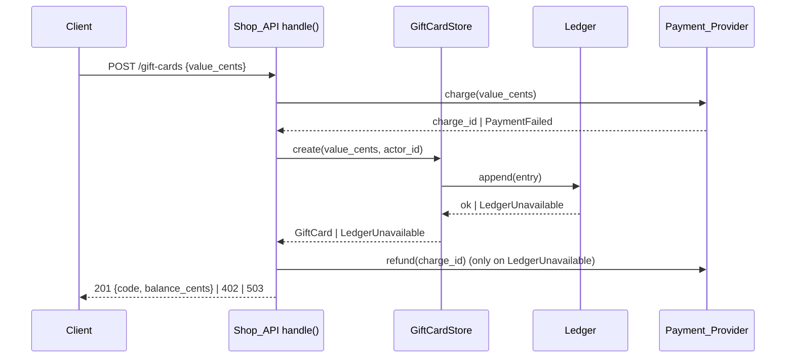

# Design Document: gift-cards

## Overview

Add three small modules beside the existing shop core: an in-memory `GiftCardStore` that owns cards, balances and status; a `Ledger` that records every balance or status change; and a `PaymentProvider` protocol with a fake for tests. `shop/api.py` gets three routes that call the store. The store holds one `threading.Lock` so redemptions of one card run one after the other. For every change the store computes the new state, appends the ledger entry, and only then commits the state, so a ledger failure leaves state unchanged.

**Key design decisions:**
- Money in cents: `value_cents` 1000–50000 (10–500 dollars). Request bodies carry cents to match `Cart.subtotal_cents()`.
- Purchase value outside 1000–50000 cents → HTTP 400 `bad_value`, no charge (gap left by analyze F6 option B; conservative).
- Ledger before commit: entry appended before the state change is committed, so 5.2 holds without rollback.
- F8 (Open Question): creation entry has `old = None`. Changes with no Actor use actor id `system`. No system change exists in this feature (no expiry job, 4.2).
- F11 (Open Question): ledger failure on purchase → refund, then HTTP 503 `ledger_unavailable`. Refund failure → HTTP 503 `refund_failed`. No Gift_Card in both cases.
- F12 (Open Question): void route checks the Actor role first (403), then the code (404 `unknown_card`). Voiding a card that is already `void` → HTTP 200, no ledger entry (no change).
- F13 (Open Question): missing `actor`, or a `role` other than `staff`, counts as non-staff → HTTP 403 `forbidden`.
- Shopper redemption and purchase use `actor.id` when present, else `anonymous`.
- No expiry: no code path changes status except the void route (4.1, 4.2).
- Code: `secrets.choice` over `A–Z0–9`, 16 characters; retry on collision.

## Architecture



Flow:
1. Purchase: validate value → charge → `store.create` → on ledger failure refund → response.
2. Redeem `POST /carts/<id>/gift-card {code}`: look up cart → `store.redeem(code, cart.subtotal_cents(), actor_id)` under the lock → checks in order: unknown (404), void (409), insufficient (422), ledger (503) → 200 `{balance_cents}`.
3. Void `POST /gift-cards/<code>/void`: role check (403) → `store.void(code, actor_id)` → unknown (404), ledger (503) → 200 `{code, status}`.

## File/Folder Structure

```diff
 shop/
 ├── api.py              # add 3 gift card routes
+├── giftcards.py        # GiftCard, GiftCardStore, errors, lock
+├── ledger.py           # LedgerEntry, Ledger, LedgerUnavailable
+└── payments.py         # PaymentProvider protocol, FakePaymentProvider, errors
 tests/
+├── test_giftcards.py      # store properties (P3, P4, P6)
+└── test_giftcards_api.py  # API properties (P1, P2, P5) + examples
```

## Components and Interfaces

### Ledger (`shop/ledger.py`)

Append-only list of entries. `fail=True` makes every append raise (test hook for 5.2).

```python
@dataclass(frozen=True)
class LedgerEntry:
    code: str
    field: str            # "balance" | "status"
    old: int | str | None # None at creation
    new: int | str
    actor_id: str
    ts: str               # UTC ISO 8601, ends with "+00:00"

class LedgerUnavailable(Exception): ...

class Ledger:
    def __init__(self, fail: bool = False) -> None: ...
    entries: list[LedgerEntry]
    def append(self, entry: LedgerEntry) -> None: ...  # raises LedgerUnavailable when fail
```

_Requirements: 5.1, 5.2_

### PaymentProvider (`shop/payments.py`)

External dependency boundary. Fake records charges and refunds.

```python
class PaymentFailed(Exception): ...
class RefundFailed(Exception): ...

class PaymentProvider(Protocol):
    def charge(self, amount_cents: int) -> str: ...  # charge id; raises PaymentFailed
    def refund(self, charge_id: str) -> None: ...     # raises RefundFailed

class FakePaymentProvider:
    def __init__(self, fail_charge: bool = False, fail_refund: bool = False) -> None: ...
    charges: list[tuple[str, int]]
    refunds: list[str]
```

_Requirements: 1.1, 1.3, 5.3_

### GiftCardStore (`shop/giftcards.py`)

Owns cards. All mutations run under `self._lock`. Ledger append runs before the commit.

```python
@dataclass
class GiftCard:
    code: str
    balance_cents: int
    status: str  # "active" | "void"

class UnknownCard(Exception): ...
class CardVoid(Exception): ...
class InsufficientBalance(Exception): ...

class GiftCardStore:
    def __init__(self, ledger: Ledger, now: Callable[[], datetime] = utc_now) -> None: ...
    def get(self, code: str) -> GiftCard | None: ...
    def create(self, balance_cents: int, actor_id: str) -> GiftCard: ...
    def redeem(self, code: str, amount_cents: int, actor_id: str) -> GiftCard: ...
    def void(self, code: str, actor_id: str) -> GiftCard: ...
```

```diff
+redeem(code, amount, actor_id)
+  with lock
+    card = cards.get(code)        -> UnknownCard
+    card.status == "void"         -> CardVoid       (before balance check)
+    amount > card.balance_cents   -> InsufficientBalance
+    ledger.append(balance old->new)  -> LedgerUnavailable (state unchanged)
+    card.balance_cents -= amount
```

_Requirements: 1.1, 2.1, 2.2, 2.4, 2.5, 3.1, 3.2, 3.4, 4.1, 4.2, 5.1, 5.2_

### Shop_API routes (`shop/api.py`)

`ctx` gains `giftcards: GiftCardStore` and `payments: PaymentProvider`. New routes are matched before the `/carts/` block.

```diff
 handle(request, ctx)
+  POST /gift-cards                  -> _buy_gift_card
+    validate value_cents 1000..50000  -> 400 bad_value
+    payments.charge                   -> 402 payment_failed
+    giftcards.create                  -> 201 {code, balance_cents}
+      LedgerUnavailable -> payments.refund -> 503 ledger_unavailable
+                                RefundFailed -> 503 refund_failed
+  POST /gift-cards/<code>/void      -> _void_gift_card
+    actor.role != "staff"             -> 403 forbidden
+    giftcards.void                    -> 200 {code, status}
+      UnknownCard -> 404 unknown_card; LedgerUnavailable -> 503 ledger_unavailable
   /carts/<id>...
+    POST /carts/<id>/gift-card      -> _redeem_gift_card
+      giftcards.redeem(code, cart.subtotal_cents())  -> 200 {balance_cents}
+        UnknownCard 404 unknown_card; CardVoid 409 card_void;
+        InsufficientBalance 422 insufficient_balance; LedgerUnavailable 503 ledger_unavailable
```

_Requirements: 1.1, 1.2, 1.3, 2.1, 2.3, 2.4, 3.1, 3.2, 3.3, 3.4, 5.2, 5.3_

## Data Models

- `GiftCard`: `code` (16 chars, `[A-Z0-9]`), `balance_cents` (int ≥ 0), `status` (`active` | `void`).
- `LedgerEntry`: see Ledger. Purchase writes one entry `field="balance", old=None, new=value_cents`.
- Request `actor`: `{"id": str, "role": "shopper" | "staff"}`, optional.
- `ctx`: `{"carts", "inventory", "giftcards", "payments"}`.

## Criteria Classification

| Criterion | Class | Property |
|---|---|---|
| 1.1 | invariant | 1 |
| 1.2 | invariant | 1 |
| 1.3 | error-condition | 2 |
| 2.1 | model | 3 |
| 2.2 | example-only | — |
| 2.3 | error-condition | 5 |
| 2.4 | error-condition | 3 |
| 2.5 | invariant | 4 |
| 3.1 | invariant | 5 |
| 3.2 | error-condition | 5 |
| 3.3 | error-condition | 5 |
| 3.4 | error-condition | 5 |
| 4.1 | example-only | — |
| 4.2 | example-only | — |
| 5.1 | invariant | 6 |
| 5.2 | error-condition | 6 |
| 5.3 | error-condition | 2 |

## Correctness Properties

### Property 1: Purchase creates an active card with the paid value

*For any* `value_cents` in 1000–50000 with a working provider and ledger, `POST /gift-cards` SHALL return 201 with a 16-character code, charge exactly `value_cents` once, and store an `active` card with `balance_cents == value_cents`.

**Validates: Requirements 1.1, 1.2**

### Property 2: Failed purchase creates no card

*For any* `value_cents` in 1000–50000, when the charge fails the API SHALL return 402 `payment_failed`; when the ledger fails after the charge it SHALL refund that charge and return 503. In both cases the store holds no new card.

**Validates: Requirements 1.3, 5.3**

### Property 3: Redemption matches a balance model

*For any* balance `b` and amount `s` (cents, 0–100000), `redeem` SHALL leave `b - s` when `s ≤ b`, and SHALL raise `InsufficientBalance` with balance `b` when `s > b`.

**Validates: Requirements 2.1, 2.4**

### Property 4: Concurrent redemptions never overdraw

*For any* balance and list of 2–8 amounts redeemed from parallel threads, the final balance SHALL equal the start balance minus the sum of accepted amounts, and SHALL be ≥ 0.

**Validates: Requirements 2.5**

### Property 5: Void and lookup rules

*For any* card and subtotal, a staff void SHALL set `void`; a non-staff or missing actor SHALL get 403 with status unchanged; any redemption of a `void` card SHALL get 409 `card_void`, even when the subtotal exceeds the balance; an unknown code SHALL get 404 `unknown_card`.

**Validates: Requirements 2.3, 3.1, 3.2, 3.3, 3.4**

### Property 6: Ledger records every change or blocks it

*For any* sequence of create / redeem / void operations, each successful change SHALL append exactly one entry with code, old, new, actor id, and a UTC timestamp; with a failing ledger each change SHALL raise `LedgerUnavailable` and leave cards unchanged.

**Validates: Requirements 5.1, 5.2**

## Error Handling

| Failure | Cause | Behavior | User-visible result |
|---|---|---|---|
| Bad value | `value_cents` missing, not int, or outside 1000–50000 | no charge | 400 `bad_value` |
| Payment_Provider charge fails | `PaymentFailed` | no card, no ledger entry | 402 `payment_failed` |
| Ledger fails on purchase | `LedgerUnavailable` after charge | refund the charge, no card | 503 `ledger_unavailable` |
| Payment_Provider refund fails | `RefundFailed` | no card; charge stays for manual follow-up | 503 `refund_failed` |
| Ledger fails on redeem/void | `LedgerUnavailable` | state unchanged | 503 `ledger_unavailable` |
| Unknown code | `UnknownCard` | none | 404 `unknown_card` |
| Void card redeemed | `CardVoid` | none | 409 `card_void` |
| Balance too low | `InsufficientBalance` | none | 422 `insufficient_balance` |
| Non-staff void | role check | none | 403 `forbidden` |

Non-functional owners: 2.2 latency → `GiftCardStore` (in-memory dict, O(1) per call, one lock). Security (3.3 staff-only void) → Shop_API route `_void_gift_card`.

## Testing Strategy

pytest + Hypothesis. Store properties in `tests/test_giftcards.py`; API properties and examples in `tests/test_giftcards_api.py`. Examples: 2.2 (1000 redemptions finish within 2 seconds), 2.3 unknown code, 4.1/4.2 (card with a `now` 13 months later stays `active` with its balance).

| Property | Generators | Iterations |
|---|---|---|
| 1 | `integers(1000, 50000)` | ≥100 |
| 2 | `integers(1000, 50000)`, `sampled_from(["charge", "ledger"])` | ≥100 |
| 3 | `integers(0, 100000)` × 2 | ≥100 |
| 4 | `integers(0, 50000)`, `lists(integers(1, 20000), min_size=2, max_size=8)` | ≥100 |
| 5 | `integers(1000, 50000)`, `integers(0, 100000)`, `sampled_from([None, "shopper", "staff", "admin"])` | ≥100 |
| 6 | `lists(sampled_from(["create", "redeem", "void"]), max_size=10)`, `booleans()` for ledger failure | ≥100 |
