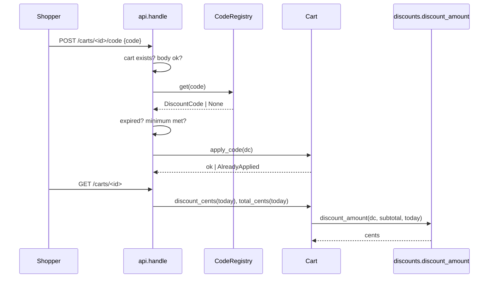

# Design Document: discount-codes

## Overview

A new module `shop/discounts.py` holds the `DiscountCode` record, its validation, the `CodeRegistry`, and one pure function `discount_amount(code, subtotal_cents, today)`. `Cart` holds at most one `DiscountCode` and asks that function for the discount. `api.handle` adds `POST` and `DELETE /carts/<id>/code` and extends `GET /carts/<id>`. Today comes from `ctx["today"]` and passes to `Cart` as an argument.

**Key design decisions:**
- Pure `discount_amount` in `shop/discounts.py`: one place for 3.1–3.3 and 4.1–4.3; easy to test with Hypothesis.
- Validation in `DiscountCode.__post_init__`: an invalid record cannot exist (1.2–1.5). `CodeRegistry.add` adds only the duplicate check (1.6).
- Cart stores the `DiscountCode` object, not the string: the API does one lookup at apply time.
- Discount is computed on read, never stored: line changes and the date are always current (4.1, 4.2).
- Today as an argument (4.4, F4 owner answer): `Cart` stays free of `ctx`.
- API check order is a fixed list (2.6): cart → body → registry → expiry → minimum → already applied.
- Open Question F7 (`expires_on` type check): out of scope. `expires_on` is typed `datetime.date`; no runtime check.

## Architecture



1. API looks up the cart (5.2), checks the body (2.7), looks up the code (2.2), checks expiry (2.3) and minimum (2.4).
2. `Cart.apply_code` refuses a second code (2.5).
3. On `GET`, `Cart` computes the discount from the current subtotal and Today (3.x, 4.x).

## File/Folder Structure

```diff
 shop/
+├── discounts.py          # DiscountCode, CodeRegistry, discount_amount
 ├── cart.py               # + applied_code, apply_code, clear_code, discount_cents, total_cents
 └── api.py                # + POST/DELETE /carts/<id>/code, GET adds discount fields
 tests/
+├── test_discounts.py     # Properties 1, 2, 4, 5 + registry examples
+├── test_cart_discount.py # Property 3 + cart examples
+└── test_api_codes.py     # Property 6 + route examples
```

## Components and Interfaces

### Discounts (`shop/discounts.py`)

Record, validation, registry, pure discount math.

```python
import re
from dataclasses import dataclass
from datetime import date
from typing import Literal

CODE_RE = re.compile(r"[A-Z0-9-]{1,20}")
PERCENT_MIN, PERCENT_MAX = 1, 50

@dataclass(frozen=True)
class DiscountCode:
    code: str
    kind: Literal["percent", "fixed"]
    value: int
    expires_on: date
    min_subtotal_cents: int = 0
    def __post_init__(self) -> None: ...  # ValueError on 1.2–1.5

class CodeRegistry:
    def __init__(self) -> None: self._codes: dict[str, DiscountCode] = {}
    def add(self, dc: DiscountCode) -> None: ...  # ValueError on duplicate (1.6)
    def get(self, code: str) -> DiscountCode | None: ...

def is_expired(dc: DiscountCode, today: date) -> bool: ...   # today > expires_on
def discount_amount(dc: DiscountCode | None, subtotal_cents: int, today: date) -> int: ...
```

```diff
+discount_amount(dc, subtotal, today)
+  if dc is None -> 0
+  if subtotal < dc.min_subtotal_cents -> 0
+  if is_expired(dc, today) -> 0
+  if dc.kind == "percent" -> subtotal * dc.value // 100
+  else -> min(dc.value, subtotal)
```

_Requirements: 1.1, 1.2, 1.3, 1.4, 1.5, 1.6, 3.1, 3.2, 3.3, 4.1, 4.2, 4.3_

### Cart (`shop/cart.py`)

Holds at most one code. Computes discount and total on read.

```python
class AlreadyApplied(Exception): ...

class Cart:
    applied_code: DiscountCode | None  # None at init
    def apply_code(self, dc: DiscountCode) -> None: ...  # AlreadyApplied if one is held
    def clear_code(self) -> None: ...
    def discount_cents(self, today: date) -> int: ...
    def total_cents(self, today: date) -> int: ...
```

```diff
 Cart.total_cents(today)
   subtotal_cents()
+  discount_cents(today)
+    discounts.discount_amount(applied_code, subtotal, today)
+  return subtotal - discount
```

_Requirements: 2.5, 3.3, 3.4, 4.3, 4.4, 5.1, 5.3_

### API (`shop/api.py`)

New routes. `ctx` gains `"codes": CodeRegistry` and `"today": date`.

```python
def handle(request: dict, ctx: dict) -> dict: ...
# POST   /carts/<id>/code  body {"code": str}  -> 200 {"code", "discount_cents", "total_cents"}
# DELETE /carts/<id>/code                    -> 200 {"code": None, ...}
# GET    /carts/<id>                         -> 200 {"lines", "subtotal_cents", "code", "discount_cents", "total_cents"}
```

```diff
 handle(request, ctx)
   cart = ctx["carts"].get(id)            # None -> 404 no cart (5.2)
+  POST .../code
+    body code missing / not str          -> 400 bad code (2.7)
+    ctx["codes"].get(code) is None       -> 404 unknown code (2.2)
+    is_expired(dc, ctx["today"])         -> 410 code expired (2.3)
+    subtotal < dc.min_subtotal_cents     -> 422 minimum not met (2.4)
+    cart.apply_code(dc) raises AlreadyApplied -> 409 code already applied (2.5)
+    -> 200 (2.1)
+  DELETE .../code
+    cart.clear_code() -> 200 (5.1, 5.3)
   GET
-    {lines, subtotal_cents}
+    {lines, subtotal_cents, code, discount_cents, total_cents} (3.5)
```

_Requirements: 2.1, 2.2, 2.3, 2.4, 2.5, 2.6, 2.7, 3.5, 5.1, 5.2, 5.3_

## Data Models

- `DiscountCode` (frozen dataclass): `code: str` (`[A-Z0-9-]{1,20}`), `kind: "percent" | "fixed"`, `value: int` (percent 1–50; fixed ≥ 1 cent), `expires_on: date` (valid through that day), `min_subtotal_cents: int ≥ 0` (default 0).
- `ctx["codes"]: CodeRegistry`, `ctx["today"]: datetime.date`.
- Error body: `{"error": "<text>"}` as in the existing API.

## Criteria Classification

| Criterion | Class | Property |
|---|---|---|
| 1.1 | error-condition | 5 |
| 1.2 | error-condition | 5 |
| 1.3 | error-condition | 5 |
| 1.4 | error-condition | 5 |
| 1.5 | error-condition | 5 |
| 1.6 | example-only | — |
| 2.1 | model | 6 |
| 2.2 | model | 6 |
| 2.3 | model | 6 |
| 2.4 | model | 6 |
| 2.5 | model | 6 |
| 2.6 | model | 6 |
| 2.7 | model | 6 |
| 3.1 | model | 1 |
| 3.2 | model | 2 |
| 3.3 | invariant | 3 |
| 3.4 | invariant | 3 |
| 3.5 | example-only | — |
| 4.1 | invariant | 4 |
| 4.2 | invariant | 4 |
| 4.3 | invariant | 4 |
| 4.4 | example-only | — |
| 5.1 | example-only | — |
| 5.2 | model | 6 |
| 5.3 | example-only | — |

## Correctness Properties

### Property 1: Percent discount is floor of percent of subtotal

*For any* valid `percent` DiscountCode, subtotal ≥ its minimum, and today ≤ `expires_on`, `discount_amount` SHALL equal `subtotal * value // 100`.

**Validates: Requirements 3.1**

### Property 2: Fixed discount is capped at subtotal

*For any* valid `fixed` DiscountCode, subtotal ≥ its minimum, and today ≤ `expires_on`, `discount_amount` SHALL equal `min(value, subtotal)`.

**Validates: Requirements 3.2**

### Property 3: Total stays between 0 and subtotal

*For any* cart lines, optional DiscountCode, and today, `Cart.total_cents(today)` SHALL equal `subtotal_cents() - discount_cents(today)` and lie in `0..subtotal_cents()`; with no code, `discount_cents(today)` SHALL be 0.

**Validates: Requirements 3.3, 3.4**

### Property 4: Invalid applied code gives zero discount

*For any* valid DiscountCode, subtotal, and today where subtotal < `min_subtotal_cents` or today > `expires_on`, `discount_amount` SHALL be 0.

**Validates: Requirements 4.1, 4.2, 4.3**

### Property 5: Code record validation

*For any* `code` string, kind, `value`, and `min_subtotal_cents`, `DiscountCode(...)` SHALL succeed exactly when `code` matches `[A-Z0-9-]{1,20}`, percent `value` is in 1–50 or fixed `value` ≥ 1, and `min_subtotal_cents` ≥ 0; else it SHALL raise `ValueError`; a valid record added to an empty `CodeRegistry` SHALL be returned by `get(code)`.

**Validates: Requirements 1.1, 1.2, 1.3, 1.4, 1.5**

### Property 6: POST code status follows the check order

*For any* combination of cart known/unknown, body valid/invalid, code known/unknown, expired/not, minimum met/not, and code already held/not, `POST /carts/<id>/code` SHALL return the status and error of the first met condition in the order 5.2, 2.7, 2.2, 2.3, 2.4, 2.5, else 200 with the code applied.

**Validates: Requirements 2.1, 2.2, 2.3, 2.4, 2.5, 2.6, 2.7, 5.2**

## Error Handling

| Cause | Behavior | User-visible result |
|---|---|---|
| Unknown cart id | no state change | 404 `no cart` |
| Body has no `code` / not str | no state change | 400 `bad code` |
| Code not in registry | no state change | 404 `unknown code` |
| Today > `expires_on` at apply | no state change | 410 `code expired` |
| Subtotal < minimum at apply | no state change | 422 `minimum not met` |
| Cart already holds a code | existing code kept | 409 `code already applied` |
| Code expires or minimum lost after apply | code stays held | `discount_cents` 0 on GET |
| Invalid record or duplicate add | registry unchanged | `ValueError` to operator |

External dependency: none new. `CodeRegistry` is in memory.

## Testing Strategy

Unit examples with pytest; properties with Hypothesis (`@settings(max_examples=200)`). Command: `uv run --no-project --with pytest --with hypothesis python -m pytest -q`.

| Property | Generators | Iterations |
|---|---|---|
| 1 | `value` 1–50, subtotal 0–10⁷, min ≤ subtotal, today ≤ expires_on | 200 |
| 2 | `value` 1–10⁷, subtotal 0–10⁷, min ≤ subtotal, today ≤ expires_on | 200 |
| 3 | cart lines from CATALOG (qty 1–5), optional valid code, today in ±30 days of expiry | 200 |
| 4 | valid code, subtotal < min or today > expires_on | 200 |
| 5 | `code` text from A–Z0–9-, lowercase and other chars (len 0–25), kind, `value` −10..200, min −10..10⁴ | 200 |
| 6 | six booleans for the conditions | 200 |
