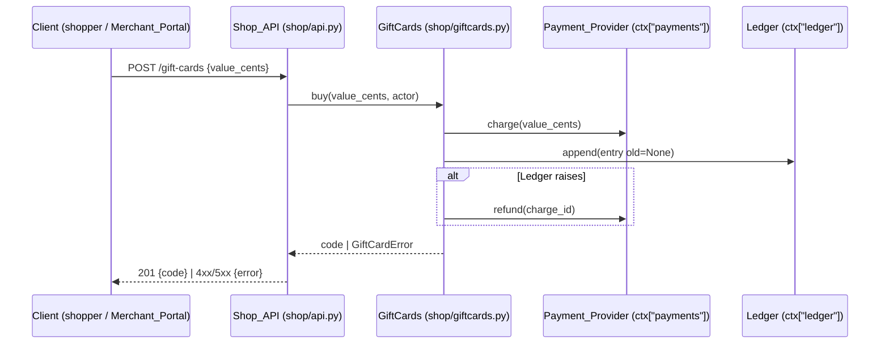

# Design Document: gift-cards

## Overview

Add one in-memory domain module `shop/giftcards.py` that owns Gift_Card state, money rules, check order and Ledger writes. Two small modules define the external ports: `shop/payments.py` (Payment_Provider) and `shop/ledger.py` (Ledger). `shop/api.py` only parses requests, reads `ctx`, and maps domain errors to HTTP status and error codes. Every change writes its Ledger entry **before** it mutates state, so a Ledger failure leaves state unchanged.

**Key design decisions:**
- Money in integer cents only: 10–500 dollars = 1000–50000 cents; 1000 dollars = 100000 cents. No floats.
- Ledger-first commit: compute the new value, append the Ledger entry, then mutate. Ledger raises → no mutation → 503 (5.2).
- Purchase order: validate value → charge → generate code → Ledger append → store card. Ledger raises after charge → refund (1.7); refund raises → 503 `refund_failed` (1.8), else 503 `ledger_unavailable`.
- Fixed check order for redemption: unknown (404) → void (409, 3.7) → balance above 100000 (422 `balance_too_high`, 2.7) → subtotal above balance (422 `insufficient_balance`) → subtract.
- Fixed check order for void: role not `staff` (403, 3.5, 3.6) → unknown (404) → already void (200, no Ledger entry) → set `void`.
- No expiry job and no time-based status change exists (4.1, 4.2). Status changes only through void.
- Open Question F17 (2.2 load condition): decided. 2.2 is measured as p95 over 1000 sequential in-process redemption requests through `handle`. Load above one caller is out of scope (in-memory, single-threaded shop).
- Concurrent redemption of one card: out of scope. `handle` is synchronous and single-threaded; no locking.
- Code: 16 characters from `A–Z0–9` via `secrets.choice`; regenerate on collision.

## Architecture



Flows:
1. Buy: `POST /gift-cards` body `{"value_cents": int}` → `GiftCards.buy` → 201 `{"code"}`.
2. Redeem: `POST /carts/{cart_id}/gift-card` body `{"code": str}` → `GiftCards.redeem(code, cart.subtotal_cents(), actor)` → 200 `{"balance_cents"}`.
3. Void: `POST /gift-cards/{code}/void` → `GiftCards.void(code, actor)` → 200 `{"status": "void"}`.

## File/Folder Structure

```diff
 shop/
 ├── api.py              # routes; maps GiftCardError → HTTP
+├── giftcards.py        # GiftCard, GiftCards service, GiftCardError
+├── payments.py         # PaymentProvider protocol, PaymentError, RefundError, FakePaymentProvider
+└── ledger.py           # LedgerEntry, Ledger protocol, ListLedger, FailingLedger
 tests/
+├── test_giftcards_props.py  # Hypothesis properties 1–12
+└── test_giftcards_api.py    # handle() examples + latency check
```

## Components and Interfaces

### Payments port (`shop/payments.py`)

Payment_Provider contract and a test fake.

```python
class PaymentError(Exception): ...
class RefundError(Exception): ...

class PaymentProvider(Protocol):
    def charge(self, amount_cents: int) -> str: ...   # charge_id; raises PaymentError
    def refund(self, charge_id: str) -> None: ...     # raises RefundError

class FakePaymentProvider:
    def __init__(self, fail_charge: bool = False, fail_refund: bool = False) -> None: ...
    charges: list[tuple[str, int]]   # (charge_id, amount_cents)
    refunds: list[str]
```

_Requirements: 1.1, 1.3, 1.7, 1.8_

### Ledger port (`shop/ledger.py`)

```python
@dataclass(frozen=True)
class LedgerEntry:
    code: str
    field: Literal["balance", "status"]
    old: int | str | None        # None on creation (5.3)
    new: int | str
    actor_id: str
    at: datetime                 # tz=UTC

class LedgerError(Exception): ...

class Ledger(Protocol):
    def append(self, entry: LedgerEntry) -> None: ...   # raises LedgerError

class ListLedger(list): append(entry)                    # default store at ctx["ledger"]
class FailingLedger: append(entry) -> raises LedgerError # test double
```

_Requirements: 5.1, 5.2, 5.3_

### GiftCards service (`shop/giftcards.py`)

Owns cards, rules and check order.

```python
MIN_CENTS, MAX_CENTS, REDEEM_CAP_CENTS = 1000, 50000, 100000

@dataclass
class GiftCard:
    code: str
    balance_cents: int
    status: Literal["active", "void"] = "active"

class GiftCardError(Exception):
    def __init__(self, http: int, error: str) -> None: ...

class GiftCards:
    def __init__(self, payments: PaymentProvider, ledger: Ledger,
                 clock: Callable[[], datetime] = utc_now) -> None: ...
    cards: dict[str, GiftCard]
    def buy(self, value_cents: int, actor_id: str) -> str: ...
    def redeem(self, code: str, subtotal_cents: int, actor_id: str) -> int: ...   # new balance
    def void(self, code: str, actor: dict) -> GiftCard: ...
```

```diff
+buy(value_cents, actor_id)
+  if value_cents not in 1000..50000 -> GiftCardError(400, "bad_value")
+  charge_id = payments.charge(value_cents)       # PaymentError -> GiftCardError(402, "payment_failed")
+  code = new_code()
+  try ledger.append(entry(code, "balance", None, value_cents))
+  except LedgerError
+    try payments.refund(charge_id)
+    except RefundError -> GiftCardError(503, "refund_failed")
+    -> GiftCardError(503, "ledger_unavailable")
+  cards[code] = GiftCard(code, value_cents)
+  return code
+
+redeem(code, subtotal, actor_id)
+  card = cards.get(code)        or -> (404, "unknown_card")
+  card.status == "void"         -> (409, "card_void")
+  card.balance > 100000         -> (422, "balance_too_high")
+  subtotal > card.balance       -> (422, "insufficient_balance")
+  new = card.balance - subtotal
+  ledger.append(entry(code, "balance", card.balance, new))   # LedgerError -> (503, "ledger_unavailable")
+  card.balance = new
+
+void(code, actor)
+  actor["role"] != "staff"      -> (403, "forbidden")
+  card = cards.get(code)        or -> (404, "unknown_card")
+  card.status == "void"         -> return card            # 200, no Ledger entry
+  ledger.append(entry(code, "status", "active", "void"))   # LedgerError -> (503, "ledger_unavailable")
+  card.status = "void"
```

_Requirements: 1.1, 1.2, 1.3, 1.4, 1.5, 1.6, 1.7, 1.8, 2.1, 2.3, 2.4, 2.5, 2.6, 2.7, 3.1, 3.2, 3.3, 3.4, 3.5, 3.6, 3.7, 4.1, 4.2, 5.1, 5.2, 5.3_

### Shop_API routes (`shop/api.py`)

`ctx` gains `"giftcards": GiftCards` and `"actor": {"id", "role"}`. `GiftCardError` → `{"status": e.http, "body": {"error": e.error}}`.

```diff
 handle(request, ctx)
+  POST /gift-cards            -> giftcards.buy(body["value_cents"], actor["id"])        -> 201 {code}
+  POST /gift-cards/{code}/void -> giftcards.void(code, actor)                           -> 200 {status}
   POST /carts                 -> create cart
   /carts/{id}
     POST .../lines            -> cart.add
+    POST .../gift-card        -> giftcards.redeem(body["code"], cart.subtotal_cents(), actor["id"]) -> 200 {balance_cents}
     GET                       -> cart view
+  except GiftCardError e      -> {status: e.http, body: {error: e.error}}
```

_Requirements: 1.2, 2.2, 3.1, 3.5_

## Data Models

- `GiftCard`: `code: str` (16 chars `[A-Z0-9]`), `balance_cents: int ≥ 0`, `status: "active" | "void"`.
- `LedgerEntry`: `code, field, old, new, actor_id, at (UTC)`.
- `ctx` keys: `carts`, `inventory`, `giftcards: GiftCards`, `actor: {"id": str, "role": "shopper" | "staff"}`. `GiftCards` holds `payments` (Payment_Provider) and `ledger` (Ledger, default `ListLedger` = `ctx["ledger"]`).

## Criteria Classification

| Criterion | Class | Property |
|---|---|---|
| 1.1 | model | 1 |
| 1.2 | invariant | 1 |
| 1.3 | error-condition | 3 |
| 1.4 | error-condition | 3 |
| 1.5 | error-condition | 2 |
| 1.6 | error-condition | 2 |
| 1.7 | error-condition | 4 |
| 1.8 | error-condition | 4 |
| 2.1 | model | 5 |
| 2.2 | example-only | — |
| 2.3 | error-condition | 7 |
| 2.4 | error-condition | 8 |
| 2.5 | error-condition | 6 |
| 2.6 | invariant | 6 |
| 2.7 | error-condition | 7 |
| 3.1 | model | 9 |
| 3.2 | error-condition | 7 |
| 3.3 | error-condition | 8 |
| 3.4 | idempotence | 9 |
| 3.5 | error-condition | 10 |
| 3.6 | error-condition | 10 |
| 3.7 | error-condition | 7 |
| 4.1 | invariant | 12 |
| 4.2 | invariant | 12 |
| 5.1 | round-trip | 11 |
| 5.2 | error-condition | 4, 11 |
| 5.3 | invariant | 11 |

## Correctness Properties

### Property 1: Purchase creates an active card

*For any* `value_cents` in 1000–50000 with a working Payment_Provider and Ledger, `buy` SHALL charge exactly `value_cents` once, return a 16-character `[A-Z0-9]` code, and store an `active` card with `balance_cents == value_cents`.

**Validates: Requirements 1.1, 1.2**

### Property 2: Out-of-range value is rejected without a charge

*For any* integer `value_cents` outside 1000–50000, `buy` SHALL raise `(400, "bad_value")`, make no charge, and store no card.

**Validates: Requirements 1.5, 1.6**

### Property 3: Charge failure creates no card

*For any* valid `value_cents` with a failing charge, `buy` SHALL raise `(402, "payment_failed")` and store no card.

**Validates: Requirements 1.3, 1.4**

### Property 4: Ledger failure on purchase refunds

*For any* valid `value_cents` with a failing Ledger, `buy` SHALL store no card and refund the charge id; the error SHALL be `(503, "ledger_unavailable")` when the refund works and `(503, "refund_failed")` when it fails.

**Validates: Requirements 1.7, 1.8, 5.2**

### Property 5: Redemption subtracts the subtotal

*For any* `active` card with balance `b ≤ 100000` and subtotal `s ≤ b`, `redeem` SHALL return and store `b − s`.

**Validates: Requirements 2.1**

### Property 6: Insufficient balance leaves balance unchanged

*For any* `active` card with balance `b ≤ 100000` and subtotal `s > b`, `redeem` SHALL raise `(422, "insufficient_balance")` and keep balance `b`.

**Validates: Requirements 2.5, 2.6**

### Property 7: Redemption check order

*For any* card status, balance `b ≥ 0` and subtotal `s ≥ 0`, `redeem` SHALL raise `(409, "card_void")` when `void`; else `(422, "balance_too_high")` when `b > 100000`; else follow Property 5 or 6.

**Validates: Requirements 2.3, 2.7, 3.2, 3.7**

### Property 8: Unknown code

*For any* code not in the store, `redeem` and staff `void` SHALL raise `(404, "unknown_card")`.

**Validates: Requirements 2.4, 3.3**

### Property 9: Void is idempotent

*For any* `active` card, staff `void` SHALL set status `void`; a second staff `void` SHALL succeed, keep status `void`, and add no Ledger entry.

**Validates: Requirements 3.1, 3.4**

### Property 10: Non-staff void is forbidden

*For any* actor role other than `staff` and any code (known or unknown), `void` SHALL raise `(403, "forbidden")` and change no card.

**Validates: Requirements 3.5, 3.6**

### Property 11: Ledger replays to state

*For any* sequence of buy / redeem / void operations, each balance or status change SHALL add exactly one Ledger entry with code, old, new, actor id and a UTC timestamp; creation entries SHALL have `old is None`; replaying entries SHALL rebuild every card's balance and status. With a failing Ledger, redeem and void SHALL raise `(503, "ledger_unavailable")` and change no card.

**Validates: Requirements 5.1, 5.2, 5.3**

### Property 12: No expiry

*For any* clock advance of 0–3650 days with no redemption, an `active` card SHALL stay `active` with unchanged balance.

**Validates: Requirements 4.1, 4.2**

## Error Handling

| Cause | Behavior | User-visible result |
|---|---|---|
| Value outside 1000–50000 cents | no charge, no card | 400 `bad_value` |
| Payment_Provider `charge` raises `PaymentError` | no card | 402 `payment_failed` |
| Ledger `append` raises on purchase | refund charge, no card | 503 `ledger_unavailable` |
| Refund raises `RefundError` after Ledger failure | no card; charge stays (operator reconciles) | 503 `refund_failed` |
| Ledger `append` raises on redeem / void | no mutation | 503 `ledger_unavailable` |
| Unknown code | — | 404 `unknown_card` |
| Card `void` on redeem | — | 409 `card_void` |
| Balance above 100000 cents | — | 422 `balance_too_high` |
| Subtotal above balance | balance unchanged | 422 `insufficient_balance` |
| Non-staff void | — | 403 `forbidden` |

## Testing Strategy

- Property tests (Hypothesis) on `GiftCards` with `FakePaymentProvider`, `ListLedger`, `FailingLedger` and a fake clock: `tests/test_giftcards_props.py`.
- API example tests through `handle`: routes, status mapping, actor handling: `tests/test_giftcards_api.py`.
- Latency (2.2, owner: Shop_API `handle`): 1000 sequential redemptions through `handle`; assert p95 < 2 seconds.
- Run: `uv run --no-project --with pytest --with hypothesis python -m pytest -q`. Typecheck: none.

| Property | Generators | Iterations |
|---|---|---|
| 1 | `integers(1000, 50000)` | ≥100 |
| 2 | `integers() .filter(not 1000..50000)` | ≥100 |
| 3 | `integers(1000, 50000)` | ≥100 |
| 4 | `integers(1000, 50000)`, `booleans()` (refund fails) | ≥100 |
| 5 | `integers(0, 100000)` balance, subtotal `≤ b` | ≥100 |
| 6 | `integers(0, 100000)` balance, subtotal `> b` | ≥100 |
| 7 | `sampled_from(["active","void"])`, `integers(0, 200000)` ×2 | ≥100 |
| 8 | `text(alphabet=A–Z0–9, size 16)` not in store | ≥100 |
| 9 | `integers(1000, 50000)` | ≥100 |
| 10 | `sampled_from(["shopper", "", "admin"])`, known/unknown code | ≥100 |
| 11 | `lists(one_of(buy, redeem, void ops))` | ≥100 |
| 12 | `integers(0, 3650)` days | ≥100 |
