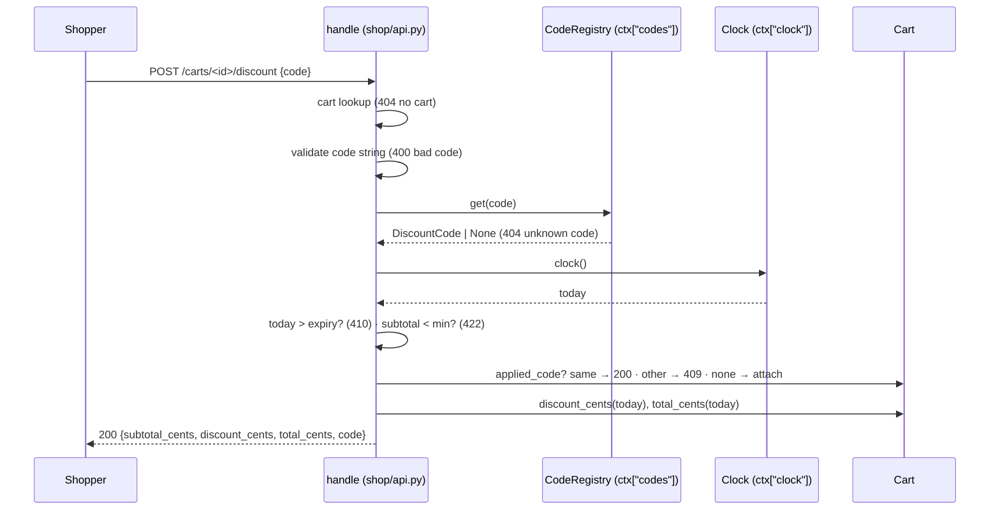

# Design Document: discount-codes

## Overview

Add a new pure module `shop/discounts.py` that holds the `DiscountCode` record, the `CodeRegistry`, and one pure function `discount_cents(code, subtotal_cents, today)`. `Cart` gets an `applied_code` slot and two methods that call that function. `shop/api.handle` gets two new routes (`POST` and `DELETE /carts/<id>/discount`) and a wider `GET /carts/<id>` body. All date logic takes `today` as an argument, so the Cart never reads a clock; only `handle` calls `ctx["clock"]()`.

**Key design decisions:**
- Discount math in one pure function: properties test it without a Cart or API.
- `Cart` takes `today` as a parameter (`discount_cents(today)`, `total_cents(today)`): the Cart does not hold the Clock (analyst VERIFY note).
- Registry errors are `ValueError` subclasses (`InvalidCode`, `DuplicateCode`): matches the existing `ValueError` use in `inventory.py`.
- Expiry compare is `today > expiry` (date objects): code is valid through the whole Expiry_Date (UTC), per Glossary.
- `GET /carts/<id>` calls `ctx["clock"]()` only when a code is applied: old callers with no `clock` key keep working.
- Open Question F7 (DELETE with no Applied_Code): decided → status 200, `discount_cents` 0, `code` null. DELETE is idempotent.
- `PERCENT_MAX = 90` is one module constant: one place to change the bound.

## Architecture



Flow:
1. `handle` finds the Cart; none → 404 `no cart` (existing branch, runs first for every `/carts/<id>` route).
2. Body check: `code` missing, not `str`, or not matching `CODE_RE` → 400 `bad code`.
3. `ctx["codes"].get(code)` is `None` → 404 `unknown code`.
4. `today = ctx["clock"]()`; `today > dc.expiry` → 410 `code expired`.
5. `cart.subtotal_cents() < dc.min_subtotal_cents` → 422 `minimum not met`.
6. `cart.applied_code` is another code → 409 `code already applied`, cart unchanged. Same code or none → attach, 200 with totals.

## File/Folder Structure

```diff
 shop/
+├── discounts.py        # DiscountCode, CodeRegistry, discount_cents(), errors, CODE_RE, PERCENT_MAX
 ├── cart.py             # + applied_code, discount_cents(today), total_cents(today)
 ├── api.py              # + POST/DELETE /carts/<id>/discount, wider GET body
 ├── catalog.py
 └── inventory.py
 tests/
 ├── test_cart.py
+├── test_discounts.py   # Properties 1–2
+├── test_cart_discount.py  # Properties 3–5
+└── test_api_discount.py   # Properties 6–8
```

## Components and Interfaces

### Discounts (`shop/discounts.py`)

Validates and stores Discount_Codes. Computes Discount_Amount.

```python
import re
from dataclasses import dataclass
from datetime import date

PERCENT_MAX = 90
CODE_RE = re.compile(r"[A-Z0-9-]{1,20}")   # used with fullmatch

class InvalidCode(ValueError): ...
class DuplicateCode(ValueError): ...

@dataclass(frozen=True)
class DiscountCode:
    code: str
    kind: str                 # "percent" | "fixed"
    value: int
    min_subtotal_cents: int
    expiry: date

class CodeRegistry:
    def register(self, code: str, kind: str, value: int,
                 min_subtotal_cents: int, expiry: str) -> DiscountCode: ...
    def get(self, code: str) -> DiscountCode | None: ...

def is_valid_code_string(s: object) -> bool: ...
def discount_cents(code: DiscountCode | None, subtotal_cents: int, today: date) -> int: ...
```

```diff
+register(code, kind, value, min_subtotal_cents, expiry)
+  if not is_valid_code_string(code)           -> InvalidCode   # 1.4
+  if kind not in ("percent", "fixed")         -> InvalidCode   # 1.8
+  if value not int (bool excluded)            -> InvalidCode
+  if kind == percent and not 1 <= value <= PERCENT_MAX -> InvalidCode  # 1.2
+  if kind == fixed and value < 1              -> InvalidCode   # 1.3
+  if min_subtotal_cents not int or < 0        -> InvalidCode   # 1.6
+  expiry_date = date.fromisoformat(expiry) with strict YYYY-MM-DD  -> InvalidCode on error  # 1.7
+  if code in store                            -> DuplicateCode # 1.5
+  store[code] = DiscountCode(...)                              # 1.1
+
+discount_cents(code, subtotal, today)
+  if code is None                  -> 0                        # 4.5
+  if today > code.expiry           -> 0                        # 4.7
+  if subtotal < code.min_subtotal_cents -> 0                   # 4.6
+  percent -> subtotal * value // 100                           # 4.1
+  fixed   -> min(value, subtotal)                              # 4.2
```

_Requirements: 1.1, 1.2, 1.3, 1.4, 1.5, 1.6, 1.7, 1.8, 4.1, 4.2, 4.3, 4.5, 4.6, 4.7_

### Cart (`shop/cart.py`)

Holds at most one Applied_Code. Delegates math to `discount_cents`.

```python
class Cart:
    applied_code: DiscountCode | None      # set in __init__ to None
    def discount_cents(self, today: date) -> int: ...
    def total_cents(self, today: date) -> int: ...   # subtotal - discount
```

```diff
 Cart.__init__(inventory)
   self.inventory = inventory
   self.lines = {}
+  self.applied_code = None
+Cart.discount_cents(today)
+  discount_cents(self.applied_code, self.subtotal_cents(), today)
+Cart.total_cents(today)
+  self.subtotal_cents() - self.discount_cents(today)
```

Expiry or a lower Subtotal never clears `applied_code` (4.8): only DELETE does.

_Requirements: 3.4, 4.1, 4.2, 4.3, 4.5, 4.6, 4.7, 4.8_

### Cart_API (`shop/api.py`)

Routes discount requests. Owns the check order.

```python
def handle(request: dict, ctx: dict) -> dict:
    """ctx = {"carts", "inventory", "codes": CodeRegistry, "clock": Callable[[], date]}"""
```

```diff
 handle(request, ctx)
   if POST /carts -> create
   if path.startswith("/carts/")
     cart lookup -> 404 no cart                                  # 2.8
+    if POST .../discount
+      code = body.get("code")
+      not is_valid_code_string(code)     -> 400 bad code        # 2.5, 2.6
+      dc = ctx["codes"].get(code) is None -> 404 unknown code   # 2.2
+      today = ctx["clock"]()
+      today > dc.expiry                  -> 410 code expired    # 2.3
+      subtotal < dc.min_subtotal_cents   -> 422 minimum not met # 2.4
+      applied_code not None and != code  -> 409 code already applied  # 3.1, 3.4
+      cart.applied_code = dc             -> 200 totals          # 2.1, 3.2
+    if DELETE .../discount
+      cart.applied_code = None           -> 200 totals          # 3.3, F7
     if POST .../lines -> existing
     if GET
-      200 {lines, subtotal_cents}
+      200 {lines, subtotal_cents, discount_cents, total_cents, code}  # 4.4
```

Totals body = `{"subtotal_cents", "discount_cents", "total_cents", "code"}`; `code` = Applied_Code's Code_String or `None`. GET and DELETE call `ctx["clock"]()` only when `applied_code` is set.

_Requirements: 2.1, 2.2, 2.3, 2.4, 2.5, 2.6, 2.7, 2.8, 3.1, 3.2, 3.3, 3.4, 4.4_

## Data Models

- `DiscountCode(code: str, kind: "percent"|"fixed", value: int, min_subtotal_cents: int, expiry: date)`, frozen.
- `ctx["codes"]: CodeRegistry`, `ctx["clock"]: Callable[[], datetime.date]` (UTC date).
- Response body for discount routes and GET: `subtotal_cents: int`, `discount_cents: int`, `total_cents: int`, `code: str | None`; GET adds `lines`.
- Errors: `{"status": <int>, "body": {"error": <str>}}` (existing shape).

## Criteria Classification

| Criterion | Class | Property |
|---|---|---|
| 1.1 | round-trip | 1 |
| 1.2 | error-condition | 1 |
| 1.3 | error-condition | 1 |
| 1.4 | error-condition | 1 |
| 1.5 | error-condition | 2 |
| 1.6 | error-condition | 1 |
| 1.7 | error-condition | 1 |
| 1.8 | error-condition | 1 |
| 2.1 | model | 6 |
| 2.2 | error-condition | 6 |
| 2.3 | error-condition | 6 |
| 2.4 | error-condition | 6 |
| 2.5 | error-condition | 6 |
| 2.6 | error-condition | 6 |
| 2.7 | model | 6 |
| 2.8 | error-condition | 6 |
| 3.1 | error-condition | 6 |
| 3.2 | idempotence | 6 |
| 3.3 | round-trip | 7 |
| 3.4 | invariant | 8 |
| 4.1 | model | 3 |
| 4.2 | model | 3 |
| 4.3 | invariant | 4 |
| 4.4 | round-trip | 7 |
| 4.5 | invariant | 5 |
| 4.6 | invariant | 5 |
| 4.7 | invariant | 5 |
| 4.8 | invariant | 8 |

## Correctness Properties

### Property 1: Registry accepts exactly the valid records

*For any* registration input (code string, kind, value, minimum, expiry text) into an empty registry, `register` SHALL succeed and `get(code)` SHALL return an equal record if and only if every field is valid per the Glossary; otherwise it SHALL raise `InvalidCode` and `get(code)` SHALL return `None`.

**Validates: Requirements 1.1, 1.2, 1.3, 1.4, 1.6, 1.7, 1.8**

### Property 2: Duplicate registration is rejected

*For any* valid record registered once, a second `register` with the same Code_String and any fields SHALL raise `DuplicateCode`, and `get` SHALL still return the first record.

**Validates: Requirements 1.5**

### Property 3: Discount formula

*For any* subtotal 0–10,000,000 cents and valid unexpired code whose minimum the subtotal meets, `discount_cents` SHALL equal `subtotal * value // 100` for `percent` and `min(value, subtotal)` for `fixed`.

**Validates: Requirements 4.1, 4.2**

### Property 4: Total stays in bounds

*For any* subtotal ≥0, any code or `None`, and any date, `0 <= subtotal - discount_cents(...) <= subtotal`.

**Validates: Requirements 4.3**

### Property 5: Zero discount when not eligible

*For any* subtotal and date, `discount_cents` SHALL be 0 when the code is `None`, when `today > expiry`, or when the subtotal is below the minimum.

**Validates: Requirements 4.5, 4.6, 4.7**

### Property 6: API status matches the check-order model

*For any* cart state (lines, applied code or none), registry content, clock date, and request body (missing, non-string, bad-format, unknown, valid code), `POST /carts/<id>/discount` SHALL return the status and error of a reference model that runs the checks in the order no cart, 400, 404, 410, 422, 409, else 200 with attach; a repeated same-code apply SHALL return 200 with unchanged totals.

**Validates: Requirements 2.1, 2.2, 2.3, 2.4, 2.5, 2.6, 2.7, 2.8, 3.1, 3.2**

### Property 7: Apply then remove round-trips

*For any* cart and valid applicable code, apply then `DELETE` SHALL leave `GET /carts/<id>` with `discount_cents` 0, `total_cents == subtotal_cents`, and `code` null; after apply alone GET SHALL show the applied Code_String and matching totals.

**Validates: Requirements 3.3, 4.4**

### Property 8: Applied code survives rejection and expiry

*For any* cart with an Applied_Code, a 409 apply of another code, a clock date past the expiry, or a line removal SHALL leave `cart.applied_code` unchanged.

**Validates: Requirements 3.4, 4.8**

## Error Handling

| Failure | Cause | Behavior | User-visible result |
|---|---|---|---|
| Bad registration field | operator input | `InvalidCode` raised, registry unchanged | exception message names the field |
| Duplicate Code_String | operator input | `DuplicateCode` raised, first record kept | exception |
| Unknown cart | bad id | existing 404 branch | 404 `no cart` |
| Bad `code` body | missing / non-str / bad format | no lookup | 400 `bad code` |
| Unknown code | not in `ctx["codes"]` | — | 404 `unknown code` |
| Expired | `clock() > expiry` | — | 410 `code expired` |
| Minimum not met | subtotal < minimum | — | 422 `minimum not met` |
| Second code | other code applied | cart unchanged | 409 `code already applied` |
| `ctx["codes"]` or `ctx["clock"]` missing (dependency) | caller misconfigured | `KeyError` propagates (programmer error, not a shopper error) | none; caught in tests |

## Testing Strategy

Library: Hypothesis with pytest. Each test file carries `# Feature: discount-codes, Property N: <title>` per property. `@settings(max_examples=200)`. Example tests stay in the same files for single cases (fixed dates). Command: `uv run --no-project --with pytest --with hypothesis python -m pytest -q`.

| Property | Generators | Iterations |
|---|---|---|
| 1 | `text()` + valid-code strategy, `sampled_from(["percent","fixed","x"])`, `integers(-10, 200)`, `integers(-5, 10**6)`, `dates()` iso text + junk text | 200 |
| 2 | valid record strategy, second record with same code | 200 |
| 3 | `integers(0, 10**7)`, valid code strategy, `dates()` ≤ expiry | 200 |
| 4 | `integers(0, 10**7)`, `none() | codes`, `dates()` | 200 |
| 5 | `integers(0, 10**7)`, codes, dates past expiry or subtotal < min | 200 |
| 6 | cart lines from CATALOG, registry of 0–3 codes, clock `dates()`, body `one_of(none, integers, text, registered codes)`, applied code or none | 200 |
| 7 | cart lines, applicable code | 200 |
| 8 | cart with applied code, other code, later dates, line removal | 200 |
