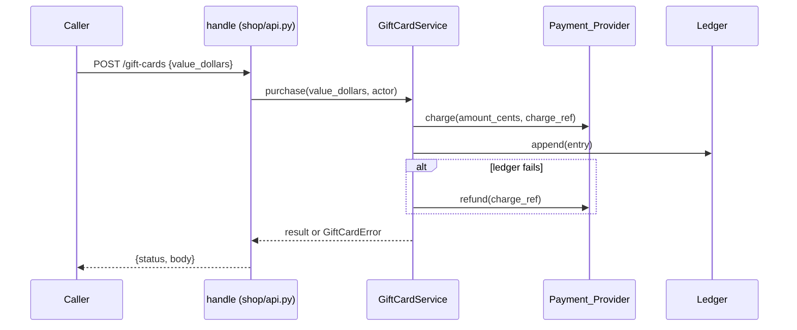

# Design Document: gift-cards

## Overview

Add an in-memory gift card service behind the existing `handle(request, ctx)` entry point. A new `GiftCardService` owns cards, the ledger write, and payment calls. It takes a lock for every change, so concurrent redemptions run one after the other. Every change writes the ledger entry first and changes state only after the write succeeds. The Payment_Provider, the ledger, and the clock come from `ctx`, so tests inject fakes.

**Key design decisions:**
- Ledger first, then state: 5.2 rejects a change when the ledger write fails, so state must stay unchanged on failure.
- One `threading.Lock` per service: simplest way to apply concurrent redemptions one after the other (2.6). Throughput is not a goal.
- Purchase order: make `charge_ref` → `charge` → ledger append → store card. Ledger failure after a charge → refund (5.3).
- Timeout: the Payment_Provider client raises `TimeoutError` when it does not answer within 10 seconds (1.5). The service does not run its own timer.
- Expiry check is lazy plus a sweep: `expire_unused(now)` voids cards with `last_used_at` 365 days or more before `now`; redeem calls the same check for its card first. "12 months" = 365 days.
- Open Question F9 (decided): a change with no user Actor (12-month void) writes actor id `system`. Card creation writes the buyer's actor id and old value `None`.
- Open Question F17 (decided, option A): if `refund(charge_ref)` raises during 1.6, write `charge_ref` to the Error_Log and still return HTTP 504 `payment_timeout`.
- Codes: 16 characters from `A–Z0–9`, made with `secrets.choice`; regenerate on collision.

## Architecture



Flow:
1. `handle` matches a `/gift-cards` route and calls one `GiftCardService` method with `ctx["actor"]`.
2. The service takes its lock, checks input and card state, and raises `GiftCardError(status, error)` on a rejected request.
3. For a change, the service builds a `LedgerEntry`, calls `ledger.append`, then changes the card.
4. `handle` maps the result or `GiftCardError` to `{"status", "body"}`.

## File/Folder Structure

```diff
 shop/
 ├── api.py              # add /gift-cards routes
+├── gift_cards.py       # GiftCard, GiftCardService, GiftCardError
+├── ledger.py           # LedgerEntry, Ledger, LedgerUnavailable
+└── payments.py         # PaymentProvider protocol, PaymentDeclined, PaymentError
 tests/
+├── test_gift_cards_props.py  # service properties
+└── test_gift_cards_api.py    # route properties and examples
```

## Components and Interfaces

### Payments (`shop/payments.py`)

Protocol for the external Payment_Provider plus its errors. No real client.

```python
class PaymentDeclined(Exception): ...
class PaymentError(Exception): ...

class PaymentProvider(Protocol):
    def charge(self, amount_cents: int, charge_ref: str) -> None: ...  # raises PaymentDeclined | PaymentError | TimeoutError
    def refund(self, charge_ref: str) -> None: ...                     # raises Exception on failure
```

_Requirements: 1.1, 1.3, 1.5, 1.6, 5.3_

### Ledger (`shop/ledger.py`)

Append-only list of entries. `append` raises `LedgerUnavailable` when the store is down (tests set `fail=True`).

```python
@dataclass(frozen=True)
class LedgerEntry:
    code: str
    field: Literal["balance", "status"]
    old: int | str | None
    new: int | str
    actor_id: str
    at: datetime  # tz=UTC

class LedgerUnavailable(Exception): ...

class Ledger:
    entries: list[LedgerEntry]
    fail: bool = False
    def append(self, entry: LedgerEntry) -> None: ...
```

_Requirements: 5.1, 5.2_

### GiftCardService (`shop/gift_cards.py`)

Owns cards, rules, lock, and payment + ledger calls.

```python
MIN_CENTS, MAX_CENTS = 1_000, 50_000
EXPIRY = timedelta(days=365)
log = logging.getLogger("shop.gift_cards")

@dataclass
class GiftCard:
    code: str
    balance_cents: int
    status: Literal["active", "void"]
    last_used_at: datetime

class GiftCardError(Exception):
    def __init__(self, status: int, error: str) -> None: ...

class GiftCardService:
    def __init__(self, payments: PaymentProvider, ledger: Ledger, clock: Callable[[], datetime]) -> None: ...
    def purchase(self, value_dollars: object, actor_id: str) -> GiftCard: ...
    def redeem(self, code: str, subtotal_cents: int, actor_id: str) -> dict: ...  # {"balance_cents", "amount_due_cents"}
    def void(self, code: str, actor: dict | None) -> GiftCard: ...
    def expire_unused(self, now: datetime) -> list[str]: ...
```

```diff
+purchase(value_dollars, actor_id)
+  check whole number and 10–500            -> GiftCardError(400, invalid_amount)
+  charge_ref = uuid4().hex
+  payments.charge(cents, charge_ref)
+    PaymentDeclined | PaymentError         -> GiftCardError(402, payment_failed)
+    TimeoutError
+      payments.refund(charge_ref)          # 1.6
+        raises -> log.error(charge_ref)    # F17 decision
+      -> GiftCardError(504, payment_timeout)
+  ledger.append(status None -> active)
+    LedgerUnavailable
+      payments.refund(charge_ref)          # 5.3
+        raises -> log.error(charge_ref); GiftCardError(503, refund_failed)
+      -> GiftCardError(503, ledger_unavailable)
+  store GiftCard(active, cents)
+
+redeem(code, subtotal_cents, actor_id)
+  with lock
+    card missing        -> GiftCardError(404, unknown_card)
+    expire check (4.2)
+    card void           -> GiftCardError(409, card_void)
+    new = max(0, balance - subtotal); due = max(0, subtotal - balance)
+    ledger.append(balance old -> new)      # LedgerUnavailable -> 503
+    balance = new; last_used_at = now
+
+void(code, actor)
+  actor role != staff  -> GiftCardError(403, forbidden)
+  card missing         -> GiftCardError(404, unknown_card)
+  ledger.append(status -> void); status = void
```

_Requirements: 1.1, 1.2, 1.3, 1.4, 1.5, 1.6, 2.1, 2.3, 2.4, 2.5, 2.6, 3.1, 3.2, 3.3, 3.4, 4.1, 4.2, 5.1, 5.2, 5.3, 5.4, 5.5_

### Shop_API routes (`shop/api.py`)

Adds three routes before the `no route` fallback. Builds a `GiftCardService` once per `ctx` (`ctx.setdefault("gift_cards", ...)`). Owns the 2.2 latency target: no I/O beyond the injected fakes.

| Route | Body | Success |
|---|---|---|
| `POST /gift-cards` | `{"value_dollars": int}` | 201 `{"code"}` |
| `POST /gift-cards/<code>/redeem` | `{"cart_id": str}` | 200 `{"balance_cents", "amount_due_cents"}` |
| `POST /gift-cards/<code>/void` | `{}` | 200 `{"status": "void"}` |

```diff
 handle(request, ctx)
   POST /carts
   /carts/...
+  /gift-cards...
+    service = ctx.setdefault("gift_cards", GiftCardService(ctx["payment_provider"], ctx["ledger"], ctx["clock"]))
+    try service.purchase | redeem | void
+    except GiftCardError -> {"status": e.status, "body": {"error": e.error}}
   no route
```

_Requirements: 1.2, 2.2, 2.4, 3.1, 3.3, 3.4_

## Data Models

- `GiftCard` and `LedgerEntry` above. Money in integer cents. Times are `datetime` with `tz=UTC`.
- `ctx` keys added: `payment_provider` (PaymentProvider), `ledger` (Ledger), `clock` (`() -> datetime`), `actor` (`{"id": str, "role": "shopper" | "staff"}`, may be missing), `gift_cards` (service, made on first use).

## Criteria Classification

| Criterion | Class | Property |
|---|---|---|
| 1.1 | invariant | 1 |
| 1.2 | invariant | 1 |
| 1.3 | error-condition | 3 |
| 1.4 | error-condition | 2 |
| 1.5 | error-condition | 3 |
| 1.6 | error-condition | 3 |
| 2.1 | model | 4 |
| 2.2 | example-only | — |
| 2.3 | invariant | 1 |
| 2.4 | error-condition | 6 |
| 2.5 | model | 4 |
| 2.6 | model | 5 |
| 3.1 | invariant | 6 |
| 3.2 | error-condition | 6 |
| 3.3 | error-condition | 6 |
| 3.4 | error-condition | 6 |
| 4.1 | model | 4 |
| 4.2 | metamorphic | 9 |
| 5.1 | invariant | 7 |
| 5.2 | error-condition | 7 |
| 5.3 | error-condition | 8 |
| 5.4 | error-condition | 8 |
| 5.5 | error-condition | 8 |

## Correctness Properties

### Property 1: Purchase creates an active card with the paid balance

*For any* whole dollar value v in 10–500, purchase SHALL charge v×100 cents once, create an `active` card with balance v×100 ≤ 50 000 cents, and return a 16-character code.

**Validates: Requirements 1.1, 1.2, 2.3**

### Property 2: Invalid amounts never charge

*For any* value outside 10–500 or not a whole number, purchase SHALL return 400 `invalid_amount`, make no charge, and create no card.

**Validates: Requirements 1.4**

### Property 3: Payment failures create no card

*For any* valid value and provider outcome in {declined, error, timeout, timeout + refund raises}, purchase SHALL create no card and return 402 `payment_failed` (declined, error) or 504 `payment_timeout` (timeout); on timeout it SHALL call `refund` with the `charge_ref` it sent to `charge`.

**Validates: Requirements 1.3, 1.5, 1.6**

### Property 4: Redemption matches the balance model

*For any* balance b in 0–50 000 and subtotal s ≥ 0, redeem SHALL leave balance max(0, b − s) and return amount due max(0, s − b); no other operation changes the balance.

**Validates: Requirements 2.1, 2.5, 4.1**

### Property 5: Concurrent redemptions equal sequential ones

*For any* list of subtotals redeemed on one card from parallel threads, the final balance SHALL equal the sequential result and never fall below 0.

**Validates: Requirements 2.6**

### Property 6: Void rules

*For any* code and Actor, void SHALL set `void` for a staff Actor on a known code, return 403 `forbidden` with status unchanged for a non-staff or missing Actor, and return 404 `unknown_card` for an unknown code; redeem SHALL return 409 `card_void` on a void card and 404 `unknown_card` on an unknown code.

**Validates: Requirements 2.4, 3.1, 3.2, 3.3, 3.4**

### Property 7: Ledger matches every change

*For any* sequence of purchase, redeem, and void operations, each balance or status change SHALL add exactly one ledger entry with the code, old, new, actor id, and UTC time; when the ledger fails, the operation SHALL return 503 `ledger_unavailable` and leave all cards unchanged.

**Validates: Requirements 5.1, 5.2**

### Property 8: Ledger failure at creation refunds the charge

*For any* valid purchase with a failing ledger, the service SHALL call `refund(charge_ref)`; if `refund` raises, it SHALL return 503 `refund_failed` and log the `charge_ref` to `shop.gift_cards` at `ERROR`.

**Validates: Requirements 5.3, 5.4, 5.5**

### Property 9: Expiry after 365 unused days

*For any* card and elapsed time d since last use, `expire_unused(last_used_at + d)` SHALL void the card if d ≥ 365 days and leave it unchanged otherwise.

**Validates: Requirements 4.2**

## Error Handling

| Cause | Behavior | User-visible result |
|---|---|---|
| Payment_Provider declines or errors | no card | 402 `payment_failed` |
| Payment_Provider no answer in 10 s (`TimeoutError`) | refund `charge_ref`; refund raises → log | 504 `payment_timeout` |
| Ledger down during purchase | refund `charge_ref`, no card | 503 `ledger_unavailable` |
| Ledger down + refund raises | log `charge_ref`, no card | 503 `refund_failed` |
| Ledger down during redeem / void / expiry | state unchanged | 503 `ledger_unavailable` (expiry sweep skips the card) |
| Bad amount | no charge | 400 `invalid_amount` |
| Unknown code | none | 404 `unknown_card` |
| Void card redeemed | none | 409 `card_void` |
| Non-staff void | none | 403 `forbidden` |

## Testing Strategy

Hypothesis property tests against `GiftCardService` (fakes for provider, ledger, clock) and against `handle`. Unit example for 2.2 timing. Tag comment per property: `Feature: gift-cards, Property N: <title>`. Command: `uv run --no-project --with pytest --with hypothesis python -m pytest -q`.

| Property | Generators | Iterations |
|---|---|---|
| 1 | `integers(10, 500)` | ≥100 |
| 2 | `integers()` outside 10–500, `floats()`, `text()` | ≥100 |
| 3 | `integers(10, 500)`, `sampled_from(outcomes)` | ≥100 |
| 4 | `integers(0, 50_000)`, `integers(0, 100_000)` | ≥100 |
| 5 | `lists(integers(0, 5_000), max_size=20)` | ≥100 |
| 6 | `text(min_size=16, max_size=16)`, actor `one_of(none(), fixed_dictionaries)` | ≥100 |
| 7 | `lists(sampled_from(ops))`, `booleans()` for ledger fail | ≥100 |
| 8 | `integers(10, 500)`, `booleans()` for refund raises | ≥100 |
| 9 | `integers(0, 800)` days | ≥100 |
