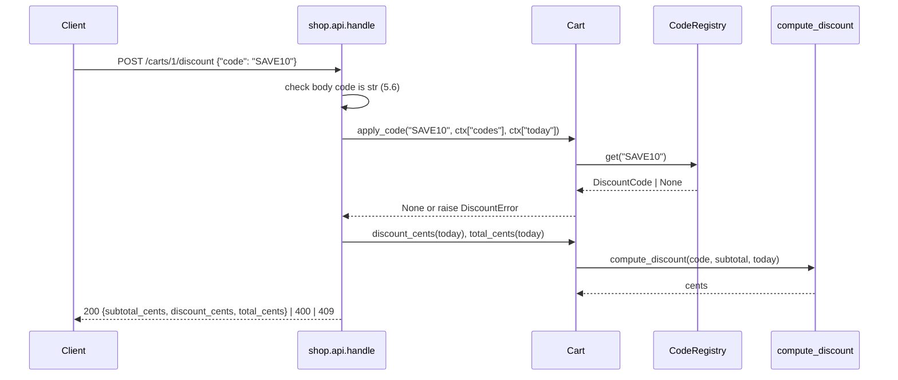

# Design Document: cart-discount-codes

## Overview

A new module `shop/discounts.py` holds the code record, the registry, the error type, and one pure function that computes a discount. `Cart` keeps at most one applied code and asks that function for the discount on each read. `shop/api.py` gets one new path, `/carts/<id>/discount`, and a wider `GET /carts/<id>` body. The registry and Today come in from the caller, so the core never reads a clock.

**Key design decisions:**
- Discount computed on read, never stored: 4.5 and 4.6 need the discount to change when the subtotal or Today changes after apply.
- One pure `compute_discount(code, subtotal, today)`: Req 4 rules sit in one place and Hypothesis tests them without a Cart.
- Validation only in `CodeRegistry.add` (Glossary Discount_Code): the dataclass stays a plain record; tests can build bad records.
- Apply checks run in the 2.7 order inside `Cart.apply_code`: one place decides which error wins.
- API maps `DiscountError` by message: `code already applied` → 409, other three → 400 (5.2, 5.3).
- Requirements `## Open Questions` is empty. Nothing to decide.

## Architecture



Flow:
1. API checks the body (5.6), then calls `Cart.apply_code`.
2. `apply_code` checks in 2.7 order: already applied, unknown, expired, below minimum. First failure raises `DiscountError`. No failure → set `applied_code`.
3. Every read (`discount_cents`, `total_cents`) calls `compute_discount` with the current subtotal and Today.
4. API maps the result or the error to a status.

## File/Folder Structure

```diff
 shop/
+├── discounts.py      # DiscountCode, DiscountError, CodeRegistry, compute_discount
 ├── cart.py           # + applied_code, apply_code, remove_code, discount_cents, total_cents
 ├── api.py            # + /carts/<id>/discount routes, GET body fields
 ├── catalog.py
 └── inventory.py
 tests/
+├── test_discounts.py      # Properties 1–6
+├── test_cart_discount.py  # Properties 7–8
+├── test_api_discount.py   # examples for Req 5
 └── test_cart.py
```

## Components and Interfaces

### Discount records and registry (`shop/discounts.py`)

Holds the record type, validates codes on add, looks codes up, and computes a discount.

```python
from dataclasses import dataclass
from datetime import date
import re

CODE_RE = re.compile(r"[A-Z0-9]{1,20}")
MAX_CENTS = 10_000_000

class DiscountError(Exception):
    """str(err) is the error text: 'unknown code' | 'expired' | 'below minimum' | 'code already applied'."""

@dataclass(frozen=True)
class DiscountCode:
    code_string: str
    kind: str              # "percent" | "fixed"
    value: int             # percent 1–50 | cents 1–10,000,000
    minimum_subtotal: int  # cents 0–10,000,000
    expiry_date: date      # usable through this date, inclusive

class CodeRegistry:
    def __init__(self) -> None: ...
    def add(self, code: DiscountCode) -> None: ...          # ValueError on any bad field or duplicate; stores nothing then
    def get(self, code_string: str) -> DiscountCode | None: ...  # exact, case-sensitive key

def compute_discount(code: DiscountCode | None, subtotal: int, today: date) -> int: ...
```

`add` checks, in order: kind, value range for that kind, code string, minimum, expiry type, duplicate. Integers must be `int` and not `bool`.

```diff
+compute_discount(code, subtotal, today)
+  if code is None                         -> 0   (4.3)
+  if today > code.expiry_date             -> 0   (4.6)
+  if subtotal < code.minimum_subtotal     -> 0   (4.5)
+  if code.kind == "percent"               -> subtotal * code.value // 100   (4.1)
+  else                                    -> min(code.value, subtotal)       (4.2)
```

_Requirements: 1.1, 1.2, 1.3, 1.4, 1.5, 1.6, 1.7, 4.1, 4.2, 4.3, 4.5, 4.6_

### Cart (`shop/cart.py`)

Holds at most one applied code. Runs the apply checks. Gives discount and total on read.

```python
class Cart:
    applied_code: DiscountCode | None   # None after __init__

    def apply_code(self, code_string: str, registry: CodeRegistry, today: date) -> None: ...
    def remove_code(self) -> None: ...
    def discount_cents(self, today: date) -> int: ...
    def total_cents(self, today: date) -> int: ...   # subtotal_cents() - discount_cents(today)
```

```diff
+Cart.apply_code(code_string, registry, today)
+  if self.applied_code is not None        -> raise DiscountError("code already applied")   (2.5)
+  code = registry.get(code_string)
+  if code is None                         -> raise DiscountError("unknown code")           (2.2)
+  if today > code.expiry_date             -> raise DiscountError("expired")                (2.3)
+  if self.subtotal_cents() < code.minimum_subtotal -> raise DiscountError("below minimum") (2.4)
+  self.applied_code = code                                                                 (2.1)
+Cart.remove_code()
+  self.applied_code = None                                                                 (3.1, 3.2)
```

_Requirements: 2.1, 2.2, 2.3, 2.4, 2.5, 2.6, 2.7, 3.1, 3.2, 4.3, 4.4, 4.5, 4.6_

### API routes (`shop/api.py`)

Adds the discount path and wider cart body. `ctx` gains `codes: CodeRegistry` and `today: date`.

```python
def _totals(cart: Cart, today: date) -> dict:
    return {"subtotal_cents": ..., "discount_cents": ..., "total_cents": ...}
```

```diff
 handle(request, ctx)
   POST /carts
   /carts/<id>
     cart lookup -> 404 "no cart"
+    POST   .../discount
+      body["code"] missing or not str      -> 400 {"error": "bad code"}           (5.6)
+      cart.apply_code(code, ctx["codes"], ctx["today"])
+        DiscountError "code already applied" -> 409 {"error": msg}               (5.3)
+        DiscountError other                -> 400 {"error": msg}                 (5.2)
+      -> 200 _totals(cart, today)                                                (5.1)
+    DELETE .../discount
+      cart.remove_code()
+      -> 200 _totals(cart, today)                                                (5.4)
     POST .../lines
     GET
-      -> 200 {lines, subtotal_cents}
+      -> 200 {lines, code, **_totals(cart, today)}                               (5.5)
```

The `/discount` checks go before the existing `/lines` check. `path.endswith("/discount")` selects them.

_Requirements: 5.1, 5.2, 5.3, 5.4, 5.5, 5.6_

## Data Models

- `DiscountCode`: frozen dataclass above. All money in integer cents.
- `ctx`: `{"carts": {id: Cart}, "inventory": Inventory, "codes": CodeRegistry, "today": date}`.
- API body shapes:
  - `POST /carts/<id>/discount` in: `{"code": str}`. Out 200: `{"subtotal_cents": int, "discount_cents": int, "total_cents": int}`. Out 4xx: `{"error": str}`.
  - `GET /carts/<id>` out: `{"lines": {sku: qty}, "code": str | None, "subtotal_cents": int, "discount_cents": int, "total_cents": int}`.

## Criteria Classification

| Criterion | Class | Property |
|---|---|---|
| 1.1 | round-trip | 2 |
| 1.2 | error-condition | 1 |
| 1.3 | error-condition | 1 |
| 1.4 | error-condition | 1 |
| 1.5 | error-condition | 1 |
| 1.6 | round-trip | 2 |
| 1.7 | error-condition | 1 |
| 2.1 | model | 7 |
| 2.2 | error-condition | 7 |
| 2.3 | error-condition | 7 |
| 2.4 | error-condition | 7 |
| 2.5 | error-condition | 7 |
| 2.6 | error-condition | 7 |
| 2.7 | model | 7 |
| 3.1 | idempotence | 8 |
| 3.2 | idempotence | 8 |
| 4.1 | model | 4 |
| 4.2 | model | 5 |
| 4.3 | invariant | 6 |
| 4.4 | invariant | 3 |
| 4.5 | invariant | 6 |
| 4.6 | invariant | 6 |
| 5.1 | example-only | — |
| 5.2 | example-only | — |
| 5.3 | example-only | — |
| 5.4 | example-only | — |
| 5.5 | example-only | — |
| 5.6 | example-only | — |

## Correctness Properties

### Property 1: Registry accepts exactly the valid codes

*For any* DiscountCode with each field drawn in or out of its bound, `CodeRegistry.add` SHALL succeed if and only if every field is valid and the Code_String is new; on `ValueError` the registry contents SHALL stay unchanged.

**Validates: Requirements 1.2, 1.3, 1.4, 1.5, 1.7**

### Property 2: Add then get round-trip

*For any* set of valid DiscountCodes with distinct Code_Strings added to a registry, `get(c.code_string)` SHALL return `c` for each, and `get(s)` SHALL return `None` for any string `s` not added.

**Validates: Requirements 1.1, 1.6**

### Property 3: Discount bounds and total

*For any* Cart lines, valid or absent applied code, and Today, `0 ≤ discount_cents(today) ≤ subtotal_cents()` and `total_cents(today) == subtotal_cents() - discount_cents(today)`.

**Validates: Requirements 4.4**

### Property 4: Percent formula

*For any* active percent code (Today ≤ expiry, subtotal ≥ minimum) and subtotal 0–10,000,000, `compute_discount` SHALL equal `subtotal * value // 100`.

**Validates: Requirements 4.1**

### Property 5: Fixed formula

*For any* active fixed code and subtotal 0–10,000,000, `compute_discount` SHALL equal `min(value, subtotal)`.

**Validates: Requirements 4.2**

### Property 6: Inactive code gives zero

*For any* subtotal and Today, `compute_discount` SHALL be 0 when the code is `None`, when Today is after the expiry date, or when the subtotal is below the minimum.

**Validates: Requirements 4.3, 4.5, 4.6**

### Property 7: Apply matches the precedence model

*For any* Cart (with or without an applied code), registry, code string, and Today, `apply_code` SHALL raise `DiscountError` with the first failing error in the 2.7 order, leaving `applied_code` unchanged, or, with no failure, set `applied_code` to the registry's code.

**Validates: Requirements 2.1, 2.2, 2.3, 2.4, 2.5, 2.6, 2.7**

### Property 8: Remove is idempotent

*For any* Cart with or without an applied code, calling `remove_code()` one or more times SHALL raise nothing and leave `applied_code` as `None`.

**Validates: Requirements 3.1, 3.2**

## Error Handling

| Failure | Cause | Behavior | Visible result |
|---|---|---|---|
| Bad code definition | operator passes out-of-range field, bad kind, bad date, duplicate | `CodeRegistry.add` raises `ValueError`, stores nothing | exception to operator code |
| Unknown code | text not an exact key | `apply_code` raises `DiscountError("unknown code")` | API 400 |
| Expired code | Today > expiry | `DiscountError("expired")` | API 400 |
| Below minimum | subtotal < minimum | `DiscountError("below minimum")` | API 400 |
| Second code | cart already holds one | `DiscountError("code already applied")` | API 409 |
| Bad body | `code` missing or not str | no call to Cart | API 400 `bad code` |
| Unknown cart | id not in `ctx["carts"]` | existing branch | API 404 `no cart` |
| Missing ctx key | caller omits `codes` or `today` | `KeyError` propagates (caller contract, Data Models) | not handled; caller bug |

No external dependency: registry and Today are in-process values the caller injects.

## Testing Strategy

- Property tests: Hypothesis, `@settings(max_examples=100)` at least. Each test file carries `# Feature: cart-discount-codes, Property N: <title>` per property.
- Example tests: `tests/test_api_discount.py` drives `handle` for every Req 5 criterion with a fixed registry and Today.
- Command: `uv run --no-project --with pytest --with hypothesis python -m pytest -q`.

| Property | Generators | Iterations |
|---|---|---|
| 1 | `st.sampled_from(["percent","fixed","other"])`, `st.integers(-5, 10_000_005)`, `st.text` / `st.from_regex`, `st.dates()` or non-date values | ≥100 |
| 2 | lists of valid DiscountCodes with unique code strings, `st.text()` for misses | ≥100 |
| 3 | cart lines from `CATALOG` skus × qty 1–5, optional valid code, `st.dates()` | ≥100 |
| 4 | valid percent codes, subtotal `st.integers(0, 10_000_000)`, Today ≤ expiry | ≥100 |
| 5 | valid fixed codes, subtotal `st.integers(0, 10_000_000)`, Today ≤ expiry | ≥100 |
| 6 | any code or None, subtotal, Today with expired or below-minimum cases | ≥100 |
| 7 | cart with lines and optional pre-applied code, registry of valid codes, code string from registry keys or `st.text()`, `st.dates()` | ≥100 |
| 8 | cart with optional applied code, call count 1–3 | ≥100 |
