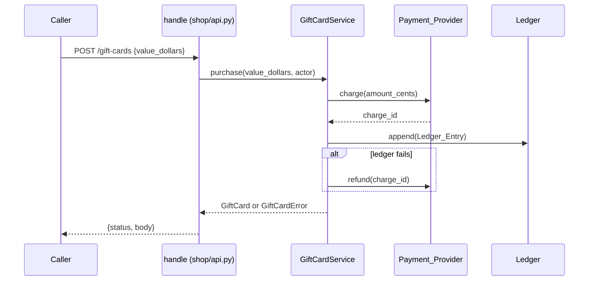

# Design Document: gift-cards

## Overview

Add an in-memory `GiftCardService` behind the existing `handle(request, ctx)` entry point. The service owns cards, the check order, one lock, and the calls to the Payment_Provider and the ledger. Every change writes its Ledger_Entry first and changes state only after the write succeeds. The Payment_Provider, the ledger and the clock come from `ctx`, so tests inject fakes. Three routes in `shop/api.py` map service results and `GiftCardError` to `{"status", "body"}`.

**Key design decisions:**
- Ledger first, then state: 5.2 says a failed ledger write rejects the change, so state must stay unchanged.
- One `threading.Lock` per service around every read-modify-write: simplest way to meet 2.6.
- Purchase order: actor → amount → `charge` → ledger append → store card. A ledger failure after the charge calls `refund` (5.3).
- Redeem check order: actor (401) → code (404) → `void` (409 `card_void`) → balance > 100 000 cents (422) → subtotal > balance (409 `insufficient_balance`) → subtract.
- Open Question F19 (decided, option A): `card_void` wins over `balance_too_high`. A void card reveals nothing about its balance.
- Open Question F20 (decided, option A): 401 `actor_required` comes before every other check, the `void` check included.
- Void with an unknown code returns 404 `unknown_card` (same error as 2.4). The spec does not state it; this reuses the existing error.
- Creation writes one Ledger_Entry: `old = None`, `new = balance_cents`. A redeem writes old/new balance; a void writes old/new status.
- Codes: 16 characters from `A–Z0–9` with `secrets.choice`; regenerate on collision.
- No expiry job exists (4.1). Nothing reads the clock except the ledger timestamp.

## Architecture



Flow:
1. `handle` matches a `/gift-cards` route and calls one service method with `ctx.get("actor")`.
2. The service runs the checks in the order above and raises `GiftCardError(status, error)` on the first that fails.
3. For a change, it builds a `LedgerEntry`, calls `ledger.append`, then changes the card.
4. `handle` maps the result or the error to a response dict.

## File/Folder Structure

```diff
 shop/
 ├── api.py              # add /gift-cards routes
+├── gift_cards.py       # GiftCard, GiftCardError, GiftCardService
+├── ledger.py           # LedgerEntry, Ledger, LedgerUnavailable
+└── payments.py         # PaymentProvider protocol, PaymentDeclined, PaymentError
 tests/
+├── test_gift_cards_service.py  # service properties
+└── test_gift_cards_api.py      # route properties + 2.2 timing example
```

## Components and Interfaces

### Payments (`shop/payments.py`)

Protocol for the external Payment_Provider and its errors. No real client.

```python
class PaymentDeclined(Exception): ...
class PaymentError(Exception): ...

class PaymentProvider(Protocol):
    def charge(self, amount_cents: int) -> str: ...   # returns charge_id; raises PaymentDeclined | PaymentError
    def refund(self, charge_id: str) -> None: ...     # raises any Exception on failure
```

_Requirements: 1.3, 1.5, 5.3, 5.4_

### Ledger (`shop/ledger.py`)

Append-only list of Ledger_Entry records. `fail = True` makes `append` raise (tests use it).

```python
@dataclass(frozen=True)
class LedgerEntry:
    code: str
    old: int | str | None
    new: int | str
    actor_id: str
    at: datetime  # tz=UTC

class LedgerUnavailable(Exception): ...

@dataclass
class Ledger:
    entries: list[LedgerEntry] = field(default_factory=list)
    fail: bool = False
    def append(self, entry: LedgerEntry) -> None: ...
```

_Requirements: 5.1, 5.2_

### GiftCardService (`shop/gift_cards.py`)

Owns cards, the lock, check order, and payment + ledger calls.

```python
MIN_DOLLARS, MAX_DOLLARS = 10, 500
MAX_REDEEM_BALANCE_CENTS = 100_000

@dataclass
class GiftCard:
    code: str
    balance_cents: int
    status: Literal["active", "void"]

class GiftCardError(Exception):
    def __init__(self, status: int, error: str) -> None: ...

class GiftCardService:
    cards: dict[str, GiftCard]
    def __init__(self, payments: PaymentProvider, ledger: Ledger, clock: Callable[[], datetime]) -> None: ...
    def purchase(self, value_dollars: object, actor: dict | None) -> GiftCard: ...
    def redeem(self, code: str, subtotal_cents: int, actor: dict | None) -> GiftCard: ...
    def void(self, code: str, actor: dict | None) -> GiftCard: ...
```

```diff
+purchase(value_dollars, actor)
+  actor is None                          -> GiftCardError(401, actor_required)
+  not int (bool excluded) or not 10–500  -> GiftCardError(400, invalid_amount)
+  charge_id = payments.charge(cents)
+    PaymentDeclined                      -> GiftCardError(402, payment_declined)
+    PaymentError                         -> GiftCardError(502, payment_failed)
+  with lock
+    ledger.append(code, None -> cents, actor id)
+      LedgerUnavailable
+        payments.refund(charge_id)
+          raises -> GiftCardError(503, refund_failed)
+        -> GiftCardError(503, ledger_unavailable)
+    store GiftCard(code, cents, active)
+
+redeem(code, subtotal_cents, actor)
+  actor is None                          -> GiftCardError(401, actor_required)
+  with lock
+    card missing                         -> GiftCardError(404, unknown_card)
+    card void                            -> GiftCardError(409, card_void)
+    balance > 100_000                    -> GiftCardError(422, balance_too_high)
+    subtotal > balance                   -> GiftCardError(409, insufficient_balance)
+    ledger.append(balance old -> new)    # LedgerUnavailable -> GiftCardError(503, ledger_unavailable)
+    balance -= subtotal
+
+void(code, actor)
+  actor role != "staff" (None included)  -> GiftCardError(403, forbidden)
+  with lock
+    card missing                         -> GiftCardError(404, unknown_card)
+    ledger.append(status old -> void)    # LedgerUnavailable -> 503
+    status = void
```

_Requirements: 1.1, 1.2, 1.3, 1.4, 1.5, 2.1, 2.3, 2.4, 2.5, 2.6, 3.1, 3.2, 3.3, 4.1, 5.1, 5.2, 5.3, 5.4, 5.5_

### Shop_API routes (`shop/api.py`)

Three routes before the `no route` fallback. One service per `ctx`, made on first use. Owns the 2.2 latency target: no I/O beyond the injected fakes, one lock hold per request.

| Route | Body | Success |
|---|---|---|
| `POST /gift-cards` | `{"value_dollars": int}` | 201 `{"code", "balance_cents"}` |
| `POST /gift-cards/<code>/redeem` | `{"cart_id": str}` | 200 `{"balance_cents"}` |
| `POST /gift-cards/<code>/void` | `{}` | 200 `{"status": "void"}` |

```diff
 handle(request, ctx)
   POST /carts
   /carts/...
+  /gift-cards...
+    if "gift_cards" not in ctx: ctx["gift_cards"] = GiftCardService(ctx["payment_provider"], ctx["ledger"], ctx["clock"])
+    redeem: cart = ctx["carts"].get(body["cart_id"]); missing -> 404 {"error": "no cart"}
+    try service.purchase | redeem | void (actor = ctx.get("actor"))
+    except GiftCardError as e -> {"status": e.status, "body": {"error": e.error}}
   no route
```

_Requirements: 1.2, 2.2, 2.4, 3.1, 3.3, 5.5_

## Data Models

- `GiftCard`, `LedgerEntry` as above. Money in integer cents. `at` is `datetime` with `tz=UTC`.
- New `ctx` keys: `payment_provider` (PaymentProvider), `ledger` (Ledger), `clock` (`() -> datetime`, UTC), `actor` (Glossary Actor; may be missing), `gift_cards` (service, made on first use).
- Payment_Provider interface (`charge` → `charge_id`, `refund(charge_id)`) is a design choice; the spec names only "refund the charge".

## Criteria Classification

| Criterion | Class | Property |
|---|---|---|
| 1.1 | invariant | 1 |
| 1.2 | invariant | 1 |
| 1.3 | error-condition | 3 |
| 1.4 | error-condition | 2 |
| 1.5 | error-condition | 3 |
| 2.1 | model | 4 |
| 2.2 | example-only | — |
| 2.3 | error-condition | 6 |
| 2.4 | error-condition | 8 |
| 2.5 | model | 4 |
| 2.6 | model | 5 |
| 3.1 | invariant | 7 |
| 3.2 | error-condition | 7 |
| 3.3 | error-condition | 7 |
| 4.1 | invariant | 12 |
| 5.1 | invariant | 9 |
| 5.2 | error-condition | 9 |
| 5.3 | error-condition | 10 |
| 5.4 | error-condition | 10 |
| 5.5 | error-condition | 11 |

## Correctness Properties

### Property 1: Purchase creates an active card with the paid balance

*For any* whole dollar value v in 10–500 and any Actor, purchase SHALL charge v×100 cents once and create an `active` card with balance v×100 and a 16-character code.

**Validates: Requirements 1.1, 1.2**

### Property 2: Invalid amounts never charge

*For any* value outside 10–500 or not a whole number of dollars, purchase SHALL return 400 `invalid_amount`, make no charge, and create no card.

**Validates: Requirements 1.4**

### Property 3: Payment failures create no card

*For any* valid value and a provider that declines or errors, purchase SHALL return 402 `payment_declined` (decline) or 502 `payment_failed` (error), create no card, and write no Ledger_Entry.

**Validates: Requirements 1.3, 1.5**

### Property 4: Redemption matches the balance model

*For any* active card with balance b in 0–50 000 cents and subtotal s ≥ 0, redeem SHALL leave balance b − s when s ≤ b, and return 409 `insufficient_balance` with balance b when s > b.

**Validates: Requirements 2.1, 2.5**

### Property 5: Concurrent redemptions equal a sequential run

*For any* list of subtotals redeemed on one card from parallel threads, the final balance SHALL equal the balance after some sequential order and never fall below 0.

**Validates: Requirements 2.6**

### Property 6: Over-limit balance is rejected

*For any* active card with balance over 100 000 cents and any subtotal, redeem SHALL return 422 `balance_too_high` and leave the balance unchanged.

**Validates: Requirements 2.3**

### Property 7: Void rules

*For any* known code and Actor, void SHALL set `void` when the role is `staff` and return 403 `forbidden` with status unchanged otherwise (missing Actor included); after a void, redeem SHALL return 409 `card_void` for any subtotal.

**Validates: Requirements 3.1, 3.2, 3.3**

### Property 8: Unknown codes

*For any* code not in the store, redeem SHALL return 404 `unknown_card`.

**Validates: Requirements 2.4**

### Property 9: Ledger matches every change

*For any* sequence of purchase, redeem and void calls, each balance or status change SHALL add exactly one Ledger_Entry with code, old, new, actor id and UTC time; with a failing ledger, a redeem or void SHALL return 503 `ledger_unavailable` and leave the card unchanged.

**Validates: Requirements 5.1, 5.2**

### Property 10: Ledger failure after a charge refunds it

*For any* valid purchase with a failing ledger, the service SHALL call `refund` with the charge id and create no card; if `refund` raises, it SHALL return 503 `refund_failed`, else 503 `ledger_unavailable`.

**Validates: Requirements 5.3, 5.4**

### Property 11: Missing Actor fails first

*For any* purchase or redeem input with no Actor, the service SHALL return 401 `actor_required`, make no charge, and change no card.

**Validates: Requirements 5.5**

### Property 12: Cards stay active until voided

*For any* sequence of purchase and redeem calls with any clock values, every card SHALL stay `active` until a staff void.

**Validates: Requirements 4.1**

## Error Handling

| Cause | Behavior | User-visible result |
|---|---|---|
| No Actor on purchase/redeem | nothing runs | 401 `actor_required` |
| Bad amount | no charge | 400 `invalid_amount` |
| Payment_Provider declines | no card | 402 `payment_declined` |
| Payment_Provider error | no card | 502 `payment_failed` |
| Ledger down at purchase | refund, no card | 503 `ledger_unavailable` |
| Ledger down + refund raises | no card, charge stays | 503 `refund_failed` |
| Ledger down at redeem/void | state unchanged | 503 `ledger_unavailable` |
| Unknown code | none | 404 `unknown_card` |
| Void card redeemed | none | 409 `card_void` |
| Balance over 1000 dollars | none | 422 `balance_too_high` |
| Subtotal over balance | none | 409 `insufficient_balance` |
| Non-staff void | none | 403 `forbidden` |

## Testing Strategy

Hypothesis property tests against the service (fakes for provider, ledger, clock) and through `handle`. One example test for 2.2 timing. Tag comment per property: `Feature: gift-cards, Property N: <title>`. Command: `uv run --no-project --with pytest --with hypothesis python -m pytest -q`.

| Property | Generators | Iterations |
|---|---|---|
| 1 | `integers(10, 500)`, actor dicts | ≥100 |
| 2 | `integers()` outside 10–500, `floats()`, `text()`, `booleans()` | ≥100 |
| 3 | `integers(10, 500)`, `sampled_from(["decline", "error"])` | ≥100 |
| 4 | `integers(0, 50_000)`, `integers(0, 100_000)` | ≥100 |
| 5 | `lists(integers(0, 5_000), max_size=20)` | ≥100 |
| 6 | `integers(100_001, 10**7)`, `integers(0, 10**7)` | ≥100 |
| 7 | actor `one_of(none(), fixed_dictionaries(role=sampled_from([...])))`, `integers(0, 10**6)` | ≥100 |
| 8 | `text(min_size=1)` | ≥100 |
| 9 | `lists(sampled_from(ops))`, `booleans()` | ≥100 |
| 10 | `integers(10, 500)`, `booleans()` for refund raises | ≥100 |
| 11 | purchase/redeem inputs | ≥100 |
| 12 | `lists(ops)`, `datetimes(timezones=just(UTC))` | ≥100 |
