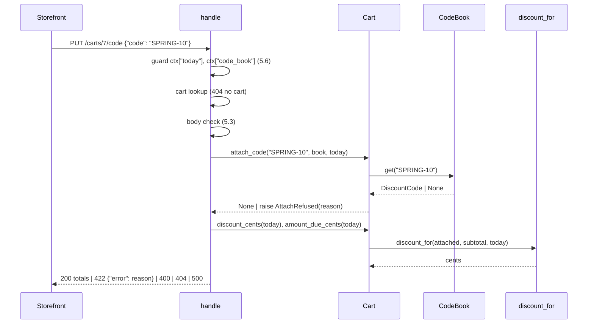

# Design Document: discount-codes

## Overview

Add one module, `shop/discounts.py`. It holds the code record, the `CodeBook`, the `AttachRefused` error, and a pure pricing function `discount_for`. `Cart` gets one new field (`attached`) and four methods that call into that module. `handle` gets a context guard and two new routes on `/carts/<id>/code`, and the `GET /carts/<id>` body gets three more keys. The caller passes the date in on every call. Nothing reads the system clock.

**Key design decisions:**
- Price on read: `discount_for` runs on each read. It is never cached, so 4.5 and 4.6 follow later changes to lines or date.
- One pure pricing function: all of Requirement 4 sits in one place that Hypothesis can drive with no Cart.
- Attach checks in 2.7 order inside `Cart.attach_code`: one function owns the reason precedence.
- F6 (deferred low): `code` in the GET body is the Code string, or `null`. A string is enough for the storefront and is JSON-safe.
- F9 (deferred low): `CodeBook.create` also refuses a non-`int` (or `bool`) Min_Subtotal and a Valid_Until that is not a `datetime.date`, with `ValueError`. This is a design guard, not a criterion.
- F11 (deferred medium): the context guard runs before the cart lookup on Requirement 5 routes. So a bad context gives 500 `bad_context`, even when the cart id is unknown. Server misconfig shows first and never looks like a client error.
- Context guard only on Requirement 5 routes (`/carts/<id>/code` and `GET /carts/<id>`): `POST /carts` and `POST /carts/<id>/lines` keep working with the old `ctx`.

## Architecture



1. `handle` checks the context first on Requirement 5 routes (5.6). A bad context returns before any Cart call (5.7).
2. Then the cart lookup, then the body check (5.3).
3. `attach_code` checks in 2.7 order and raises `AttachRefused` on the first failure. With no failure, it sets `attached`.
4. Each read calls `discount_for` with the current subtotal and date.
5. `handle` maps the result to a status.

## File/Folder Structure

```diff
 shop/
+├── discounts.py      # DiscountCode, CodeBook, AttachRefused, discount_for
 ├── cart.py           # + attached, attach_code, detach_code, discount_cents, amount_due_cents
 ├── api.py            # + context guard, PUT/DELETE /carts/<id>/code, GET body keys
 ├── catalog.py
 └── inventory.py
 tests/
+├── test_discounts.py   # Properties 1–3
+├── test_cart_codes.py  # Properties 4–6
+├── test_api_codes.py   # Property 7 + examples for 5.1–5.5
 └── test_cart.py
```

## Components and Interfaces

### Discounts module (`shop/discounts.py`)

Owns the code record, creation rules, lookup, the refusal error, and pricing.

```python
import re
from dataclasses import dataclass
from datetime import date

CODE_FORMAT = re.compile(r"[A-Z0-9-]{3,16}")
PERCENT_RANGE = (1, 50)
FIXED_RANGE = (1, 1_000_000)
MIN_SUBTOTAL_RANGE = (0, 1_000_000)

@dataclass(frozen=True)
class DiscountCode:
    code: str
    kind: str            # "percent" | "fixed"
    amount: int
    min_subtotal: int
    valid_until: date

class AttachRefused(Exception):
    def __init__(self, reason: str) -> None:
        super().__init__(reason)
        self.reason = reason   # "code_not_found" | "code_already_attached" | "code_expired" | "minimum_not_met"

class CodeBook:
    def __init__(self) -> None: ...
    def create(self, code, kind, amount, min_subtotal, valid_until) -> DiscountCode: ...  # ValueError on refusal; book unchanged
    def get(self, code: str) -> DiscountCode | None: ...

def discount_for(dc: DiscountCode | None, subtotal: int, today: date) -> int: ...
```

```diff
+CodeBook.create(code, kind, amount, min_subtotal, valid_until)
+  kind not in {percent, fixed}            -> ValueError   (1.7)
+  amount not int (bool counts as not int) -> ValueError   (1.7)
+  percent and amount outside 1–50         -> ValueError   (1.2)
+  fixed and amount outside 1–1,000,000    -> ValueError   (1.3)
+  code not str or not CODE_FORMAT.fullmatch -> ValueError (1.4)
+  min_subtotal not int or outside 0–1,000,000 -> ValueError (1.5, F9)
+  valid_until not date                    -> ValueError   (F9)
+  code already in book                    -> ValueError   (1.6)
+  store and return DiscountCode           (1.1)
+discount_for(dc, subtotal, today)
+  dc is None                  -> 0                          (4.3)
+  today > dc.valid_until      -> 0                          (4.6)
+  subtotal < dc.min_subtotal  -> 0                          (4.5)
+  dc.kind == "percent"        -> subtotal * dc.amount // 100 (4.1)
+  else                        -> min(dc.amount, subtotal)   (4.2)
```

_Requirements: 1.1, 1.2, 1.3, 1.4, 1.5, 1.6, 1.7, 4.1, 4.2, 4.3, 4.5, 4.6_

### Cart (`shop/cart.py`)

Holds zero or one attached code. Runs the attach rules. Reports discount and amount due.

```python
class Cart:
    attached: DiscountCode | None    # None after __init__

    def attach_code(self, code: str, code_book: CodeBook, today: date) -> None: ...
    def detach_code(self) -> None: ...
    def discount_cents(self, today: date) -> int: ...
    def amount_due_cents(self, today: date) -> int: ...
```

```diff
+Cart.attach_code(code, code_book, today)
+  dc = code_book.get(code)
+  dc is None                          -> raise AttachRefused("code_not_found")         (2.2, 2.7)
+  self.attached is not None           -> raise AttachRefused("code_already_attached")  (2.5, 2.7)
+  today > dc.valid_until              -> raise AttachRefused("code_expired")           (2.3, 2.7)
+  self.subtotal_cents() < dc.min_subtotal -> raise AttachRefused("minimum_not_met")    (2.4, 2.7)
+  self.attached = dc                                                                   (2.1)
+  (every raise happens before any write)                                               (2.6)
+Cart.detach_code()
+  self.attached = None                                                                 (3.1, 3.2)
+Cart.discount_cents(today)   -> discount_for(self.attached, self.subtotal_cents(), today)
+Cart.amount_due_cents(today) -> self.subtotal_cents() - self.discount_cents(today)    (4.4)
```

_Requirements: 2.1, 2.2, 2.3, 2.4, 2.5, 2.6, 2.7, 3.1, 3.2, 4.3, 4.4, 4.5, 4.6_

### Handler (`shop/api.py`)

Adds the context guard, the code routes, and the GET keys.

```python
def _context_ok(ctx: dict) -> bool: ...            # "code_book" in ctx and isinstance(ctx.get("today"), date)
def _prices(cart: Cart, today: date) -> dict: ...  # subtotal_cents, discount_cents, amount_due_cents
```

```diff
 handle(request, ctx)
   POST /carts
   /carts/<id>...
+    route is /carts/<id>/code or GET /carts/<id>, and not _context_ok(ctx)
+                                         -> 500 {"error": "bad_context"}             (5.6, 5.7, F11)
     cart lookup                          -> 404 {"error": "no cart"}
+    PUT .../code
+      body.get("code") not str           -> 400 {"error": "invalid_body"}           (5.3)
+      cart.attach_code(code, ctx["code_book"], ctx["today"])
+        AttachRefused as e               -> 422 {"error": e.reason}                 (5.2)
+      -> 200 _prices(cart, today)                                                   (5.1)
+    DELETE .../code
+      cart.detach_code()                 -> 200 _prices(cart, today)                (5.4)
     POST .../lines                        (unchanged, no guard)
     GET
-      -> 200 {lines, subtotal_cents}
+      -> 200 {lines, code: attached.code | None, **_prices(cart, today)}            (5.5, F6)
```

_Requirements: 5.1, 5.2, 5.3, 5.4, 5.5, 5.6, 5.7_

## Data Models

- `DiscountCode` (frozen dataclass above). All money is integer cents.
- `ctx` = `{"carts": {id: Cart}, "inventory": Inventory, "code_book": CodeBook, "today": date}`. `code_book` and `today` are needed only on Requirement 5 routes.
- `PUT /carts/<id>/code`. Request body: `{"code": str}`. Response 200: `{"subtotal_cents": int, "discount_cents": int, "amount_due_cents": int}`. Response 4xx/5xx: `{"error": str}`.
- `GET /carts/<id>` response 200: `{"lines": {sku: qty}, "code": str | None, "subtotal_cents": int, "discount_cents": int, "amount_due_cents": int}`.

## Criteria Classification

| Criterion | Class | Property |
|---|---|---|
| 1.1 | round-trip | 2 |
| 1.2 | error-condition | 1 |
| 1.3 | error-condition | 1 |
| 1.4 | error-condition | 1 |
| 1.5 | error-condition | 1 |
| 1.6 | error-condition | 2 |
| 1.7 | error-condition | 1 |
| 2.1 | model | 5 |
| 2.2 | error-condition | 5 |
| 2.3 | error-condition | 5 |
| 2.4 | error-condition | 5 |
| 2.5 | error-condition | 5 |
| 2.6 | invariant | 5 |
| 2.7 | model | 5 |
| 3.1 | idempotence | 6 |
| 3.2 | idempotence | 6 |
| 4.1 | model | 3 |
| 4.2 | model | 3 |
| 4.3 | model | 3 |
| 4.4 | invariant | 4 |
| 4.5 | model | 3 |
| 4.6 | model | 3 |
| 5.1 | example-only | — |
| 5.2 | example-only | — |
| 5.3 | example-only | — |
| 5.4 | example-only | — |
| 5.5 | example-only | — |
| 5.6 | error-condition | 7 |
| 5.7 | invariant | 7 |

## Correctness Properties

### Property 1: Create accepts exactly valid fields

*For any* code, kind, amount, min_subtotal and valid_until drawn both in and out of range, `CodeBook.create` SHALL succeed if and only if every field is valid, and on `ValueError` the book SHALL hold the same codes as before.

**Validates: Requirements 1.2, 1.3, 1.4, 1.5, 1.7**

### Property 2: Create then get, duplicates keep the first

*For any* list of valid code records, after creating each in turn, `get(c)` SHALL return the first record created with Code `c`, and each later create with a used Code SHALL raise `ValueError`.

**Validates: Requirements 1.1, 1.6**

### Property 3: Pricing matches the reference model

*For any* code record or `None`, subtotal 0–2,000,000 and date, `discount_for` SHALL equal the model: 0 when None, expired or below minimum; else `subtotal * amount // 100` for percent and `min(amount, subtotal)` for fixed.

**Validates: Requirements 4.1, 4.2, 4.3, 4.5, 4.6**

### Property 4: Amount due identity

*For any* cart lines, attached code or none, and date, `0 <= discount_cents(today) <= subtotal_cents()` and `amount_due_cents(today) == subtotal_cents() - discount_cents(today)`.

**Validates: Requirements 4.4**

### Property 5: Attach matches the precedence model

*For any* cart (with or without an attached code), code book, entered code and date, `attach_code` SHALL raise `AttachRefused` whose `reason` is the first failing reason in 2.7 order and leave `attached` unchanged, or, with no failure, set `attached` to the book's record.

**Validates: Requirements 2.1, 2.2, 2.3, 2.4, 2.5, 2.6, 2.7**

### Property 6: Detach is idempotent

*For any* cart with or without an attached code, calling `detach_code()` 1–3 times SHALL raise nothing and leave `attached` as `None`.

**Validates: Requirements 3.1, 3.2**

### Property 7: Bad context gives 500 and changes nothing

*For any* Requirement 5 route request (PUT, DELETE, GET on `/carts/<id>...`, any body, known or unknown id) and a `ctx` that lacks `code_book` or has a `today` that is not a `date`, `handle` SHALL answer 500 `{"error": "bad_context"}` and every cart's `lines` and `attached` SHALL stay the same.

**Validates: Requirements 5.6, 5.7**

## Error Handling

| Failure | Cause | Behavior | Visible result |
|---|---|---|---|
| Bad code record | Operator passes a field out of range, a bad type, or a used Code | `CodeBook.create` raises `ValueError`, stores nothing | exception to Operator code |
| Unknown code | entered Code not in book | `AttachRefused("code_not_found")` | 422 |
| Second code | cart already has one | `AttachRefused("code_already_attached")` | 422 |
| Expired | today > valid_until | `AttachRefused("code_expired")` | 422 |
| Below minimum | subtotal < min_subtotal | `AttachRefused("minimum_not_met")` | 422 |
| Bad body | `code` missing or not str | no Cart call | 400 `invalid_body` |
| Unknown cart | id not in `ctx["carts"]` | existing branch | 404 `no cart` |
| Bad context | `code_book` missing, `today` missing or not a date | guard returns first, no Cart call | 500 `bad_context` |

No external service. The code book and the date are in-process values that the caller passes in.

## Testing Strategy

- Property tests: Hypothesis, `@settings(max_examples=100)` or more. Each file has `# Feature: discount-codes, Property N: <title>` per property.
- Example tests: `tests/test_api_codes.py` has one example per criterion 5.1–5.5, with a fixed `CodeBook` and date.
- Command: `uv run --no-project --with pytest --with hypothesis python -m pytest -q`.

| Property | Generators | Iterations |
|---|---|---|
| 1 | `st.sampled_from(["percent","fixed","pct"])`, `st.one_of(st.integers(-10, 1_000_010), st.floats(), st.booleans())`, codes from `st.from_regex` plus `st.text()`, `st.one_of(st.dates(), st.text())` | ≥100 |
| 2 | lists of valid records, with Codes drawn from a small pool so duplicates occur | ≥100 |
| 3 | valid record or `None`, `st.integers(0, 2_000_000)`, `st.dates()` | ≥100 |
| 4 | lines from `CATALOG` skus × qty 1–5 on a large-stock `Inventory`, optional attached record, `st.dates()` | ≥100 |
| 5 | cart lines, optional pre-attached record, book of valid records, entered code from book keys or `st.text()`, `st.dates()` | ≥100 |
| 6 | cart with optional attached record, call count 1–3 | ≥100 |
| 7 | method/path from the Requirement 5 routes, id known or unknown, any JSON-like body, ctx with `code_book` dropped or `today` replaced by a non-date | ≥100 |
